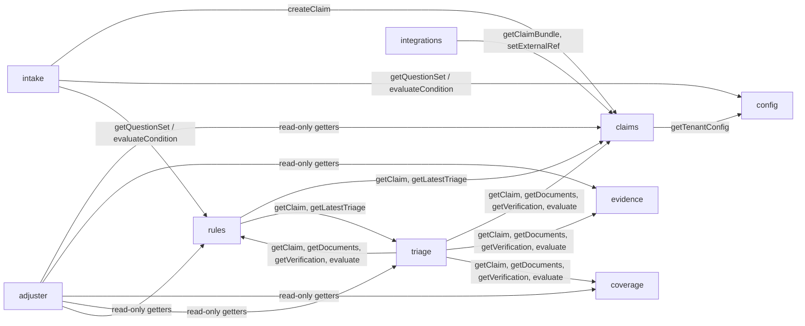

# Module contracts (v1.2.0)

Owner: dir-architecture · Implements ADR-001 (module contract, `ctx` shape, layout)

**Changes in 1.2.0 (S2-ARC-01, additive).** Reconciled with the built code after the Sprint 1 architecture-hub requests: sync/async notes per module, config owns no table, intake narrative and step fields, claims `claim.updated` event and extra service functions, coverage 1.1.0 kept and extended with `searchByQuery` and commercial auto, triage severity bands (ADR-003), rules routing precedence with worked examples, adjuster derived flags and next actions, the new `kpi` module, the per-tenant outbox sequence, and the core envelope and crypto as built. Coverage stays at section version 1.1.0 plus the 1.2.0 additions marked below.

Every module in `src/modules/<name>/index.mjs` exports `{ name, migrations, routes(router, ctx), subscribe(bus, ctx), service? }`. **Addition to ADR-001 (backward compatible):** a module may export `service(ctx)`. It returns the object that core mounts at `ctx.modules.<name>`. Only the functions listed here are public. Anything else in a module is private.

## Rules for cross-module coupling

1. **Prefer events.** A module reacts to facts published by others. Synchronous calls through `ctx.modules` are allowed only where listed below, and only for reads or for a command that must return a value to an HTTP caller (for example intake submit returning the new claim).
2. **No imports across module folders.** Import only `src/core/*`, `src/ai/*` and the contracts.
3. **Tenant is implicit.** Service functions take a `ctx` that is already bound to a tenant (`ctx.tenant.id`). In event handlers, core binds `ctx` to `evt.tenantId`. A service function never takes a `tenantId` argument and never reads another tenant's data.
4. **Return domain shapes** from `architecture/contracts/domain/*.schema.json`. Errors are thrown as `AppError(code, message, status)` from `src/core`. HTTP maps them to `{ error: { code, message } }`.
5. **Writes go with events.** Each state change records `ctx.audit.record(...)` and calls `ctx.bus.publish(...)` in the same transaction (outbox).
6. **Handlers are idempotent** on `evt.id`. Core dedupes per handler, and handlers must also be safe to replay.

Signature notation: `fn(args) -> Promise<Return>`. Functions are async unless the section says **sync**. Callers should `await` every service call; awaiting a sync function is harmless, but a sync caller (for example config validation calling `rules.validateRules`) may rely only on the functions marked sync. `Actor` is `{ type, id, role }` from `common.schema.json`. Event handlers are called as `handler(evt, tctx)` with `tctx = ctx.forTenant(evt.tenantid)` (core-runtime-api.md addendum) and register with a stable `name` for per-handler dedupe.

## Dependency map

Synchronous calls only go downstream and are read-mostly. The only synchronous writes are `claims.createClaim` (from intake) and `claims.setExternalRef` and `claims.addNote` (from integrations and rules). No cycles exist at write time.

---

## config

| Function | Returns |
| --- | --- |
| `getTenantConfig()` | `TenantConfig`, cached and invalidated on `tenant.config.updated` |
| `getPublicConfig()` | `{ tenantId, displayName, branding, lobs, locales }` |
| `getQuestionSet({ lob, lossType?, channel? })` | One question set (`TenantConfig.questionSets[]`), or throws `not_found` |
| `getRules({ stage, lob?, state?, lossType?, at? })` | `Rule[]`, filtered by `appliesTo` and sorted by priority |
| `getTimerDefinitions({ state, lob })` | `TimerDefinition[]` |
| `getQueues()` | `Queue[]` |
| `validateTenantConfig(doc)` | `{ valid, errors[], warnings[] }`, covering both schema and semantic checks |
| `putTenantConfig(doc, { expectedVersion, actor })` | Saved `TenantConfig` with `version + 1` |

- **Sync (1.2.0):** every config function is synchronous (it reads `ctx.tenants`, which is in memory).
- Roles: write routes accept `tenant_admin` and its original name `carrier_admin`.
- Publishes: `tenant.config.updated`
- Consumes: nothing
- Tables: none of its own (corrected in 1.2.0). Versions live in the core system table `tenant_configs (tenant_id, version, config, actor, created_at)`, owned by `ctx.tenants` (`put`, `history`, `version`), holding every version for history and rollback
- Boot: core loads `tenants/<tenant>.json` (`ctx.tenants.loadDir()`); an identical config is a no-op
- Semantic checks in `validateTenantConfig`: referenced queues and questions exist, conditions use known facts and ops (`rules.validateRules`), `timers[].state` is a `UsState` that one of the tenant's LOBs lists in `lobs[].states`, `timers[].stopOn.toStatus[]` are lifecycle states, and start/stop events are known event types

## intake

| Function | Returns |
| --- | --- |
| `startSession({ lob, lossType?, channel, locale?, policyNumber?, actor })` | `IntakeStep` (OpenAPI `IntakeStep`, with the first question) |
| `getSession(sessionId)` | `IntakeSession` |
| `nextQuestion(sessionId)` | `IntakeStep` |
| `answer(sessionId, [{ questionId, value, provenance? }], { actor })` | `IntakeStep` (validation errors in `errors[]`). `provenance: 'ai_extraction'` confirms a pending suggestion with the same value (recorded with `confirmedBy`) |
| `narrative(sessionId, text, { actor })` | `IntakeStep` with `suggestions[]`. **Added 1.2.0.** Runs `extract_narrative`; records no answer and does not store the text |
| `submit(sessionId, { actor, idempotencyKey? })` | `Claim`, created through `claims.createClaim` |
| `expireOrphaned()` | Internal housekeeping (1.2.0); no route |

- `IntakeStep` (1.2.0, openapi `IntakeStep`): `sessionId, done, question, prompt, locale, progress, missing[{questionId,text}], optional[Question], blocked[]?, errors[]?, suggestions[]?, disclosures[]`. `question` is null when no required question is left, even if optional ones remain. `missing[]` lists required questions (static `required`, `requiredIf` true, or forced by an intake `require_question` rule) not yet answered, localized to the session locale
- Channel alias: `startSession` accepts `channel: 'csr'` and stores `csr_phone` (the `Channel` enum is unchanged)
- `mapsTo` accepts the root `loss.*` as an alias of `lossEvent.*` (tenant sample question sets use it)
- Roles: `claimant, csr, agent, integration, carrier_admin` on every intake route; a claimant reaches only the sessions it started
- Calls: `config.getQuestionSet`, `rules.evaluateCondition` and `rules.evaluate({stage:'intake'})`, `claims.createClaim`, and optionally `ctx.ai.run('extract_narrative')` for AI-prefilled suggestions (corrected in 1.2.0: `next_question` is not an AI task; the AI tasks are `extract_narrative, extract_document, classify_photo, severity, fraud_signals, subrogation, summarize, next_best_actions`)
- Publishes: none (claims publishes `claim.reported`)
- Consumes: `tenant.config.updated`, to expire active sessions only if their question-set version was removed
- Tables: `intake_sessions (tenant_id, id, status, lob, channel, question_set_id, question_set_version, doc, started_at, updated_at, expires_at)`, `intake_answers (tenant_id, session_id, question_id, value_enc, provenance, answered_at)`

## claims

| Function | Returns |
| --- | --- |
| `createClaim(input: ClaimCreate & { channel, intakeSessionId? }, { actor, idempotencyKey? })` | `Claim` (status `reported`). Publishes `claim.reported` and starts the timers configured with `startOn: claim.reported` |
| `getClaim(claimId, { include?: ['parties','vehicles','properties'] })` | `Claim` |
| `listClaims(filter, { limit, cursor })` | `{ items: Claim[], nextCursor }` |
| `getClaimBundle(claimId)` | `{ claim, parties, vehicles, properties }` with PII decrypted. Internal only, for adapters and AI with redaction |
| `changeStatus(claimId, { to, reason?, closeReason?, expectedVersion?, actor })` | `Claim`. Enforces the state machine (overview.md section 7) and publishes `claim.status.changed` |
| `addFlag(claimId, flag, { actor })` | `Claim` |
| `addNote(claimId, { body, category?, visibility?, ai? }, { actor })` | `Note`. Publishes `claim.note.added` |
| `listNotes(claimId)` | `Note[]` |
| `addTask(claimId, TaskInput, { actor, sourceRuleId? })` | `Task` |
| `updateTask(claimId, taskId, patch, { actor })` | `Task`. Completing a task can meet a timer |
| `listTasks(claimId)` | `Task[]` |
| `listTimers(claimId)` | `RegulatoryTimer[]` |
| `suggestReserve(claimId, ReserveInput)` | `Reserve` (placeholder) |
| `setExternalRef(claimId, { system, id, status })` | `Claim` |
| `applyEvent(evt)` | `Claim \| null`. **Added 1.2.0.** Applies a fact event (coverage, evidence, triage, routing) to the claim; called by the module's own subscribers. Unknown claim: logs a warning and returns null |
| `applyTimerEvent(evt)` | `void`. **Added 1.2.0.** Starts and stops timers named by `startOn` / `stopOn` |
| `sweepTimers(now)` | **Added 1.2.0.** One timer tick for the bound tenant (used by the scheduler and tests) |

- Publishes: `claim.reported`, `claim.status.changed`, `claim.note.added`, `claim.timer.due`, `claim.timer.breached`, and **`claim.updated` (added 1.2.0)**
- `claim.updated` (`events/claim.updated.schema.json`) is published for every claim mutation that has no dedicated event: `change` is one of `flag_added, routing_updated, external_ref_set, task_added, task_updated, reserve_suggested, updated_from_event, timer_started, timer_met, timer_cancelled`, with `claimId`, `version` and ids/codes only (`flag`, `taskId`, `reserveId`, `timerId`, `definitionId`, `system`, `status`, `source`, `queue`, `adjusterId`). No PII
- Task types: `addTask` stores a type outside the `Task.type` enum (for example the seeded `timer_breach_followup`, or `acknowledge_claimant` named in a timer `stopOn.taskType`) as `other` and keeps the requested type internally, so completing it still meets the timer. The internal field is never returned
- PII (1.2.0): `lossEvent.location.description` and `lossEvent.location.geo` are `x-pii` and encrypted with the other PII paths
- Consumes:
  - `claim.reported` (its own event): moves the claim to `validating`
  - `claim.coverage.verified`: sets `checks.coverage`
  - `claim.evidence.added` / `claim.evidence.extracted`: sets `checks.evidence` and `documentIds`
  - `claim.triaged`: sets `triage` and moves `validating` to `triaged`
  - `claim.routed`: sets `routing` and moves `triaged` to `assigned` or `fast_tracked`
  - `claim.status.changed` and task completions: stop timers
  - any event named in a timer definition's `startOn` or `stopOn`
- Timer tick: `setInterval` on `ctx.clock` (every 60 s, and injectable in tests). Publishes `claim.timer.due` at `warnAt` and `claim.timer.breached` at `dueAt`, then applies `onBreach` actions
- Tables: `claims (tenant_id, id, claim_number, status, lob, channel, policy_number, risk_state, severity, queue, adjuster_id, fast_track, version, doc, reported_at, updated_at)`, `claim_parties`, `claim_vehicles`, `claim_properties`, `claim_notes`, `claim_tasks`, `claim_reserves`, `claim_status_history`, `regulatory_timers (tenant_id, id, claim_id, definition_id, state, kind, warn_at, due_at, status, ...)`, `claim_number_seq (tenant_id, year, next)`

## evidence

| Function | Returns |
| --- | --- |
| `addDocument(claimId, { kind, filename, contentType, bytes: Buffer, source }, { actor })` | `Document` (extraction `pending`). Publishes `claim.evidence.added` |
| `listDocuments(claimId, { kind? })` | `Document[]` |
| `getDocument(claimId, documentId)` | `Document` |
| `readContent(claimId, documentId, { actor })` | `{ contentType, bytes }`. Audited as a sensitive read |
| `extract(documentId, { force? })` | `Document['extraction']`, run through `ctx.ai.run('extract_document' / 'classify_photo')`. Publishes `claim.evidence.extracted` |
| `reviewExtraction(documentId, [{ name, accepted, value? }], { actor })` | `Document['extraction']` |
| `getAcceptedFacts(claimId)` | `{ [fieldName]: { value, confidence, provenance } }`, used by triage |

- Extraction (1.2.0): `Document.extraction.needsReview` is `true` when a person must look (unreadable PDF, low-confidence photo, no fields found, failed run); the status is then `partial` (or `skipped` / `failed`)
- Upload limits (1.2.0): 10 MB per file by default, tenant-configurable with `TenantConfig.evidence.maxUploadBytes` (`413 payload_too_large`); allowed types `image/jpeg, image/png, image/webp, image/heic, image/gif, application/pdf, text/plain` (`415 unsupported_media_type`). The declared type is checked against the file's magic bytes; a mismatch is also `415`. Core refuses request bodies over 15 MB
- Publishes: `claim.evidence.added`, `claim.evidence.extracted`
- Consumes: `claim.evidence.added` (its own event), which runs extraction asynchronously so that upload returns fast
- Tables: `documents (tenant_id, id, claim_id, kind, content_type, size_bytes, sha256, storage_key, doc, uploaded_at)`, `extractions (tenant_id, id, document_id, status, doc, ai_provider, ai_model, confidence, completed_at)`. Blobs go in `data/blobs/<tenant>/<claim>/<doc>` (GCS on GCP)

## coverage

| Function | Returns |
| --- | --- |
| `getPolicySnapshot({ policyNumber, asOf })` | `PolicySnapshot`, or throws `not_found`, through the policy port adapter from `TenantConfig.integrations.policyPort.adapter` (default `mock-pas`). Snapshots are cached in `policy_snapshots` |
| `searchPolicies({ lastName?, postalCode?, vin?, phone? })` | `PolicySummary[]` = `{ policyNumber, lob, status, period, namedInsureds: [{ name }], vehicleCount, propertyCount }`. At least one criterion is required; criteria combine with AND. Lookup is by HMAC blind index (`ctx.crypto.hmacIndex`), so PII is never stored in a searchable plaintext column |
| `verifyCoverage(claimId, { actor?, sourceEventId? }?)` | `CoverageVerification`. Persists the result and publishes `claim.coverage.verified`. A repeated `sourceEventId` returns the stored result without a second run |
| `getLatestVerification(claimId)` | `CoverageVerification \| null` |
| `seedPolicies(policies[])` | `{ inserted }`. **Added in 1.1.0.** Loads synthetic `PolicySnapshot`-shaped docs for the bound tenant into the mock PAS (`coverage_policies`), replacing a policy with the same `policyNumber`. `namedInsureds[]` may carry `phone` (and `lastName`) for search. Throws `not_supported` when the tenant's adapter cannot seed. Used by the seed script and tests; no HTTP route |
| `getSnapshotById(id)` | `PolicySnapshot \| null`. **Added in 1.1.0.** Backs `GET /claims/{id}/coverage` |
| `searchByQuery(q)` | `{ kind, items: PolicySummary[] }`. **Added in 1.2.0.** Classifies `q` (VIN, postal code, phone, policy-number prefix, else last name; see openapi `searchPolicies`) and searches through the port. `kind` is returned as `matchedOn`. Throws `bad_request` on an empty or unclassifiable `q`. At most 25 rows, masked contact only (`domain/PolicySummary.schema.json`) |

- 1.2.0: `searchPolicies` also accepts `policyNumberPrefix` (plain indexed column, policy numbers are not PII); the adapter may implement `searchSummaries(criteria)` to return masked `PolicySummary` rows
- Calls: `claims.getClaim(claimId, { include: ['vehicles', 'properties'] })` (read)
- Publishes: `claim.coverage.verified` (ids and codes only)
- Consumes: `claim.reported`, which calls `verifyCoverage(claimId, { sourceEventId: evt.id })` automatically. Handler name `coverage:claim.reported`, idempotent on event id
- Routes: `POST /claims/{claimId}/coverage/verify`, `GET /claims/{claimId}/coverage`, `GET /policies?q=` (1.2.0; roles `csr, agent, adjuster, supervisor`), `GET /policies/{policyNumber}/snapshot` (as in openapi.yaml)
- Tables: `policy_snapshots (tenant_id, id, policy_number, as_of, doc, retrieved_at, seq)`, `coverage_verifications (tenant_id, id, claim_id, outcome, status, source_event_id, doc, verified_at, seq)`. Mock PAS data lives in `coverage_policies (tenant_id, policy_number, lob, doc, pii, last_name_idx, postal_idx, vin_idx, phone_idx)`, owned by the mock-pas adapter inside this module (renamed from `mock_policies` in 1.0.0). `pii` holds encrypted names, phones and addresses; `*_idx` columns hold comma-delimited HMAC blind indexes
- Policy port (module-internal, `port.mjs`): adapter `{ id, getPolicy({ policyNumber, asOf }) -> snapshot \| null, search(criteria), seed?(policies) }`. Only `mock-pas` is built in. Fixtures: `src/modules/coverage/fixtures.mjs` exports `policies` (9 synthetic policies) for the platform seed script

### Verification result (additive in 1.1.0)

`CoverageVerification.outcome` keeps the schema enum. The rule function also yields a finer `status`, returned as an additive field together with the deductible and limits. Consumers must ignore fields they do not know.

| `status` | `outcome` | Meaning |
| --- | --- | --- |
| `in_force` | `covered` | Policy in force on the loss date and a coverage applies. `applicableCoverages` / `matchedCoverages` list the coverage codes |
| `lapsed` | `not_covered` | Loss date outside the term, or policy cancelled or expired |
| `excluded` | `not_covered` | Vehicle or location not on the policy, coverage not purchased, or peril excluded (for example flood without the `FLOOD` endorsement, or a coverage `excludedPerils` entry such as `water_weather`) |
| `not_found` | `policy_not_found` | No policy for the reported number |
| `needs_review` | `needs_review` | Ambiguous: LOB mismatch, no policy number, insured unit not identified or only partly matched, loss cause `other` or unmapped |

Additive fields: `status`, `deductible` (`Money \| null`, same value as `applicableDeductible`), `limits` (`{ [coverageCode]: { limit?, limitPerPerson?, limitPerOccurrence? } }`), `applicableCoverages` (`string[]`). `reasons[]` entries are `"<code>: <detail>"` with no PII. A `lob_mismatch` is recorded as a failed `coverage_present` check. Glass is a comprehensive sub-coverage: a `glass` loss matches `GLASS` first (its deductible wins) and `COMP` second. Loss dates are compared in `TenantConfig.timeZone`. `percent_of_dwelling` deductibles are read as a percent of the `DWELLING` limit. The event payload is unchanged from 1.0.0.

### Commercial auto (additive in 1.2.0)

- Fleet units: `PolicySnapshot.vehicles[]` carry `unitId`, `unitType` and optional `addedDate` / `removedDate`. A claim vehicle matches by `policyVehicleId` = `unitId` or by VIN; a unit removed on or before the loss date (or added after it) fails `fleet_unit_on_policy` (status `excluded`); an unidentified unit is `needs_review`.
- Hired and non-owned autos: a claim vehicle with `role` or `ownership` of `hired` / `non_owned` is checked against the `HNOA` coverage (`hnoa_coverage`); without it the status is `excluded`.
- Cargo: `LossEvent.cargoInvolved` (or a property with role `cargo`) requires the `CARGO` endorsement and coverage (`cargo_endorsed`); otherwise `excluded` with reason `cargo_excluded`. Cargo is a flag, not a `LossCause`.
- New check codes in `CoverageVerification.checks[].code`: `fleet_unit_on_policy`, `hnoa_coverage`, `cargo_endorsed`.

## triage

| Function | Returns |
| --- | --- |
| `runTriage(claimId, { force?, actor? })` | `TriageResult`. Publishes `claim.triaged`, and skips the run when `inputsHash` is unchanged unless `force` |
| `getLatestTriage(claimId)` | `TriageResult \| null` |
| `listTriage(claimId)` | `TriageResult[]`, all attempts |

| `onEvent(kind, evt)` | **Added 1.2.0.** Entry point for the module's own subscribers (`kind` is the event type) |

- Calls: `claims.getClaimBundle`, `evidence.getAcceptedFacts`, `coverage.getLatestVerification`, `rules.evaluate({ stage: 'triage' })` (for `add_severity` and `set_complexity`), and `ctx.ai.run('severity' | 'fraud_signals' | 'subrogation' | 'summarize')`
- Publishes: `claim.triaged`
- Consumes:
  - `claim.coverage.verified`: runs the first triage
  - `claim.evidence.extracted`: re-triages if the claim is not yet `in_review` and the inputs changed
- Tables: `triage_results (tenant_id, id, claim_id, attempt, severity_score, complexity, fraud_score, subrogation, doc, provider, model, confidence, created_at)`, plus additive columns `input_hash`, `source_event_id` (1.2.0)

### Severity bands (ADR-003, documented in 1.2.0)

`severityScore` is the AI (or deterministic baseline) score plus rule `add_severity` points, clamped to 0-100. Bands use lower bounds:

| Band | Default range | Tenant override |
| --- | --- | --- |
| `minor` | 0-24 | below `severityBands.moderate` |
| `moderate` | 25-49 | `severityBands.moderate` (default 25) up to `major - 1` |
| `major` | 50-74 | `severityBands.major` (default 50) up to `severe - 1` |
| `severe` | 75-100 | `severityBands.severe` (default 75) and above |

The override is the top-level `TenantConfig.severityBands` object (for example a tenant with `{ moderate: 20, major: 45, severe: 70 }` bands a score of 47 as `major`). The scenario `expected` values in `tests/synthetic/` are the acceptance spec (ADR-003): weights are tuned to them, and an expectation changes only with a one-line rationale. Fast-track `maxSeverity` (default 25) compares against the score, not the band.

Other triage notes (1.2.0): triage reads the top-level `severityBands` (an earlier build read `triage.severityBands`, which is not in the schema); `suggestedReserve` is set from the accepted evidence `estimateTotal`; `factors[]` may include `name: 'calibration'` (platform points for total loss or not recovered, insured vehicle not drivable or towed, uninhabitable dwelling, commercial line); fraud indicator weights are normalised to 0-1 (`TriageResult.fraud.indicators[].weight`); `subrogation.confidence` (0-1) is returned with the flag; the prior-claims count is read from the bundle (`priorClaimsCount` or `priorClaims[]`) or an accepted `priorClaims` fact, and no contract source feeds it yet (0 when absent).

## rules (rule engine and routing)

| Function | Returns |
| --- | --- |
| `evaluateCondition(condition, facts)` | `{ result: boolean, trace: [{ fact, op, value, actual, result }] }`. Pure, with no I/O |
| `evaluate({ stage, facts, lob?, state?, lossType? })` | `{ fired: [{ ruleId, actions[] }], actions[], trace }`. Pure over `config.getRules` |
| `validateRules(rules[])` | `{ valid, errors[] }` (used by `config.validateTenantConfig`) |
| `buildFacts(claimId)` | The fact document (`claim`, `loss`, `policy`, `coverage`, `triage`, ...) for a claim |
| `route(claimId, { override?, actor?, sourceEventId?, auto? })` | `RoutingDecision`. Publishes `claim.routed` and creates `add_task` tasks through `claims.addTask`. `sourceEventId` (1.2.0) makes a replayed event return the stored decision; `auto` (1.2.0) marks an event-driven run, which returns the prior decision unchanged when queue and fast track are the same |
| `getRoutingDecision(claimId)` | `RoutingDecision \| null` |
| `onClaimTriaged(evt)` | **Added 1.2.0.** Handler body for `claim.triaged`; returns null when the claim is not routable |

- **Sync (1.2.0):** `evaluateCondition` and `validateRules` are synchronous (config validation calls them synchronously). `evaluate`, `buildFacts`, `route` and `getRoutingDecision` are async
- Facts (1.2.0): `answers.*` come from `intake.getSession(claim.intakeSessionId).answers` when the claim has an intake session, else from `claim.answers`
- Calls: `config.getRules`, `config.getQueues`, `claims.getClaim`, `triage.getLatestTriage`, `coverage.getLatestVerification`, and `claims.addTask` / `claims.addFlag` for actions
- Publishes: `claim.routed`
- Consumes: `claim.triaged`, which routes automatically if the claim is `triaged` (or re-routes if it is `assigned` / `fast_tracked` and the result changed the outcome)
- Tables: `routing_decisions (tenant_id, id, claim_id, outcome, queue, adjuster_id, fast_track, rule_ids, doc, decided_at)` plus additive columns `seq`, `source_event_id`, `actions`, `actions_done` (1.2.0), `queue_cursors (tenant_id, queue_id, last_adjuster_id)` for round-robin

### Routing precedence (1.2.0, corrects the 1.0.0 wording)

Routing-stage rules (filtered by `appliesTo`) run in ascending `priority`, ties broken by `id`. Every matching rule fires unless `stopOnMatch` is set. The fired actions are then combined:

1. **Queue: the first `route_queue` wins.** Low numbers are the specific rules (injury 10, SIU 20); tenant defaults sit at high numbers (for example priority 90), so a default can never override injury or SIU.
2. **`deny_fast_track` beats `fast_track`**, whatever their priorities.
3. **A requested fast track is approved only if** the tenant has `fastTrack.enabled` not false, `coverage.outcome` is `covered`, triage exists and does not set `fastTrackEligible: false`, `severityScore <= fastTrack.maxSeverity` (default 25), `fraud.score <= fastTrack.maxFraudScore` (default 20), and the estimate is not above `fastTrack.maxEstimate` when set. Otherwise the reasons are recorded as `fast track blocked: ...`.
4. **An approved fast track beats the queue rules.** The queue is the `route_queue` of the same rule that asked for the fast track, else `fastTrack.queue` (default `fast_track`).
5. When the claim is not fast tracked, a `route_queue` naming the fast-track queue is skipped. When no rule names a usable queue (including a `route_queue` without a `queue`), the tenant `defaultQueue` is used, else the first non-fast-track queue serving the LOB. A tenant with no queues gets implicit queues `general` (or its `defaultQueue`) and `fastTrack.queue`.
7. A tenant with no routing-stage rules gets the platform rule `PLATFORM-STP-DEFAULT`: fast track when `triage.fastTrackEligible` is true, still behind the guard in step 3.
6. A supervisor `override` skips rule evaluation; the queue must exist.

Worked examples (rules as in domain-model.md section 4, plus a default `RT-DEFAULT` at priority 90 routing to `auto_general`):

| Claim | Fired actions in order | Decision |
| --- | --- | --- |
| Rear-end collision, injury reported, fraud 10 | `RT-INJURY-01` route_queue `injury`, deny_fast_track; `RT-DEFAULT` route_queue `auto_general` | `assigned` to `injury` (first route_queue), no fast track |
| Glass only, severity 12, fraud 5, coverage `covered` | `RT-FT-GLASS` fast_track; `RT-DEFAULT` route_queue `auto_general` | `fast_tracked` to `fast_track` (approved fast track beats the default queue) |
| Glass only, severity 12, coverage `needs_review` | `RT-FT-GLASS` fast_track; `RT-DEFAULT` route_queue `auto_general` | `assigned` to `auto_general`; reason `fast track blocked: coverage outcome is needs_review, not covered` |
| Theft, fraud 72 | `RT-SIU-01` refer_siu, route_queue `siu`, deny_fast_track; `RT-DEFAULT` route_queue `auto_general` | `assigned` to `siu`, flag `siu` and an `siu_referral` task |

## adjuster (read models)

| Function | Returns |
| --- | --- |
| `getFirstView(claimId, { actor, refresh? })` | `AdjusterView` |
| `getInbox({ adjusterId?, queue?, limit, cursor })` | `{ items: InboxRow[], nextCursor }` |

- View (1.2.0): there is no separate `header` object; `claim` is the header. Derived flags (`siu`, `subrogation`, `coverage_question`, `timer_due`, `timer_breached`, `injury`, `fatality`, `cat`) are merged into `claim.flags` (and may be repeated in the optional top-level `flags`). Next best actions are `nextActions[]` items `{ code, label, reason, priority, source }`: rule actions (`source: 'rule'`, priority `high|medium|low`) win over AI actions with the same code (`source: 'ai'`), sorted by priority. `summary` is `{ text, bullets, citedFacts[{name,value}], explanation, unconfirmed?, ai }`, cached per triage attempt; the text ends with a `Facts used:` line. `timestamps` is `{ reportedAt, acknowledgedAt, assignedAt }` (acknowledgedAt from a `claim.acknowledged` event if a tenant emits one, else the acknowledge timer `metAt`; assignedAt from `routing.decidedAt`)
- AI provenance: `ai.tier` is the integer of `AiProvenance` (0 local, 1 cheap, 2 strong); the cascade also returns `tierName`

- Calls (read only): `claims.getClaim`, `listTimers`, `listTasks` and `listNotes`, `evidence.listDocuments`, `coverage.getLatestVerification` and `getPolicySnapshot`, `triage.getLatestTriage`, `rules.getRoutingDecision`, and `ctx.ai.run('summarize')` (cached per triage attempt)
- Publishes: none
- Consumes: `claim.reported`, `claim.triaged`, `claim.routed`, `claim.status.changed`, `claim.timer.due` and `claim.timer.breached`, to maintain the inbox projection
- Tables: `adjuster_inbox (tenant_id, claim_id, queue, adjuster_id, status, severity, next_due_at, flags, updated_at)` plus additive columns `claim_number`, `lob`, `complexity`, `next_timer`, `reported_at` (1.2.0) (a projection that can be rebuilt from the outbox), and `adjuster_summaries (tenant_id, claim_id, triage_attempt, doc)`

## integrations

| Function | Returns |
| --- | --- |
| `listSubscriptions()`, `createSubscription(input, { actor })`, `updateSubscription(id, patch, { actor })`, `deleteSubscription(id, { actor })` | `WebhookSubscription` (create also returns the `secret` once) |
| `listDeliveries(subscriptionId, page)` | `{ items: Delivery[], nextCursor }` |
| `listOutbox({ type?, subject?, afterSequence?, limit })` | `{ items: OutboxRecord[], nextSequence }`, read through `ctx.bus.outbox`. `sequence` is the row's core `seq` (see core below); until that column exists, the 1-based position in the tenant's outbox. Each `event` is normalised to `events/envelope.schema.json` (`tenantId`, `/tenants/<id>/modules/<module>` source, `sequence`) |
| `listAdapters()` | `[{ id, port, format, enabled }]` |
| `previewMapping(adapterId, claimId)` | `{ adapterId, format, payload, unmapped[], warnings[] }` |
| `pushClaim(adapterId, claimId, { actor })` | `{ externalId, status }`. Calls `claims.setExternalRef` |

- Calls: `claims.getClaimBundle`, `claims.setExternalRef`, `triage.getLatestTriage`, `coverage.getLatestVerification`
- Publishes: none in v1 (core-sync status goes on `Claim.externalRefs`; a `claim.core.synced` event is a candidate for v1.1)
- Consumes:
  - every `claim.*` event and `tenant.config.updated`: webhook fan-out to matching subscriptions
  - the event named in `TenantConfig.integrations.claimsPort.pushOn` (default `claim.routed`): `pushClaim`
- Tables: `webhook_subscriptions (tenant_id, id, url, event_types, active, secret_enc, doc)`, `webhook_deliveries (tenant_id, id, subscription_id, event_id, attempt, status, response_status, next_attempt_at, at)`, `core_sync (tenant_id, claim_id, adapter_id, external_id, status, last_payload_hash, updated_at)`

## kpi (added 1.2.0)

| Function | Returns |
| --- | --- |
| `compute({ from?, to? })` (alias `computeKpis`) | `KpiReport` (`domain/Kpi.schema.json`): `{ period: { from, to }, metrics: [{ id, label, valueDriver, value, unit, numerator, denominator, definition, note? }], truncated? }`. Defaults to the last 30 days; throws `bad_request` on invalid dates or `from > to` |

- Read only: reads through tenant-bound service functions (`claims.listClaims`, `listTimers`, `listTasks`, `triage.getLatestTriage`, `rules.getRoutingDecision`, `coverage.getLatestVerification`, `evidence.getAcceptedFacts`, `intake`) and the tenant's outbox. No writes, no PII in output
- Metrics: `stp_rate`, `automated_capture_rate` (VD-1); `median_minutes_to_acknowledgment`, `median_minutes_to_assignment` (VD-2); `coverage_verified_at_intake_rate`, `fraud_flag_rate` (VD-4); `subrogation_flag_rate` (VD-5); `digital_self_service_share`, `spanish_session_share` (VD-6); `regulatory_timers_met`, `regulatory_timers_breached` (VD-7). Each metric is isolated: a failed source gives `value: null` with a `note`; a zero denominator or empty median gives `value: null`
- Times: there is no `claim.acknowledged` event in the catalogue. Acknowledgment time is that event's time if a tenant integration emits one, else the `acknowledge` timer `metAt`; assignment time is the `claim.routed` event time, else `routing.decidedAt`
- Route: `GET /kpis` (roles `supervisor, tenant_admin, carrier_admin, auditor`)
- Publishes, consumes, tables: none

## core (platform-owned; listed for completeness)

These are not modules, but they are on `ctx`: `db`, `bus` (`publish`, `on`, `outbox(tenantId, status?)`, `drain`, `recover`), `audit.record(entry)` and `audit.list(filter)`, `crypto.encryptPii` and `decryptPii`, `ai.run(task, input, opts)`, `tenants.get(id)`, `log`, `clock`, and `modules`. Core registers `POST /auth/token` (dev mode only) and `GET /audit`; the health module registers `GET /healthz` at the server root (not under `/api/v1`). `GET /auth/me` is planned and not registered in 1.2.0.

**AI (1.2.0).** `ctx.ai` is root-bound: pass the tenant as `ai.run(task, input, { tenantId })` or use `ai.forTenant(id)`. Results carry `provider, model, confidence, tier` (integer) and `tierName`.

**Event envelope as built (1.2.0).** In process, `ctx.bus.publish(tenantId, type, subject, data)` emits `{ specversion, id, source: '/fnol-platform', type, subject, time, tenantid, datacontenttype, data }`: `tenantid` is the CloudEvents extension spelling. Handlers may read either `evt.tenantid` or the bound `tctx.tenant.id`. Every external surface (outbox API, webhooks, adapters) converts to the contract envelope with `tenantId`, a `/tenants/<id>/modules/<module>` source and `sequence`.

**Outbox sequence (1.2.0).** The outbox gets a per-tenant, strictly increasing integer column `seq` (S2-PLT-01): assigned as `MAX(seq) + 1` for the tenant in the same transaction as the insert, backfilled for existing rows in `created_at, rowid` order, unique on `(tenant_id, seq)`, never reused (rows are not deleted). `bus.outbox(tenantId)` returns rows in `seq` order and each row carries `seq`; consumers expose it as `sequence` (`OutboxRecord.sequence`, envelope `sequence`). Gaps can appear only in filtered reads. A `limit` / `after` option on `bus.outbox` is deferred; `listOutbox` filters in memory.

**PII crypto as built (1.2.0, corrects 1.0.0).** Per-tenant keys are derived with HKDF-SHA256 from one 32-byte master key in `.secrets/master.key` (tenant id as salt, purpose as info); there is no `tenant_keys` table and no wrapped data key. Ciphertext is `enc:v1:<iv>:<tag>:<ct>` (AES-256-GCM, base64url parts): `v1` is the format version, not a key id. Per-tenant rotation and crypto-shredding need a key id in the ciphertext (`enc:v2:<keyId>:...`), which is deferred to a platform ticket.

Core tables (as built): `outbox (id, tenant_id, type, subject, event, status, attempts, last_error, created_at, delivered_at, seq)`, `bus_handled (tenant_id, handler, event_id, handled_at)` for per-handler dedupe, `audit_log` (append-only, hash-chained per tenant), `tenant_configs (tenant_id, version, config, actor, created_at)` (system table), `_migrations`.

## Event matrix

| Event | Publisher | Consumers |
| --- | --- | --- |
| `claim.reported` | claims | claims, coverage, adjuster, integrations |
| `claim.evidence.added` | evidence | evidence, claims, integrations |
| `claim.evidence.extracted` | evidence | claims, triage, integrations |
| `claim.coverage.verified` | coverage | claims, triage, integrations |
| `claim.triaged` | triage | claims, rules, adjuster, integrations |
| `claim.routed` | rules | claims, adjuster, integrations |
| `claim.status.changed` | claims | claims (timers), adjuster, integrations |
| `claim.timer.due` | claims | adjuster, integrations |
| `claim.timer.breached` | claims | adjuster, integrations |
| `claim.note.added` | claims | integrations |
| `claim.updated` (1.2.0) | claims | integrations (webhooks); adjuster may refresh its projection |
| `tenant.config.updated` | config | config, intake, integrations |
