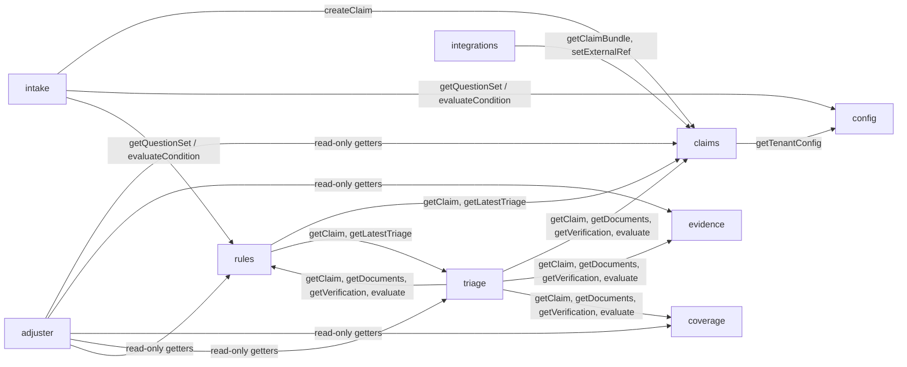

# Module contracts (v1.1.0)

Owner: dir-architecture · Implements ADR-001 (module contract, `ctx` shape, layout)

Every module in `src/modules/<name>/index.mjs` exports `{ name, migrations, routes(router, ctx), subscribe(bus, ctx), service? }`. **Addition to ADR-001 (backward compatible):** a module may export `service(ctx)`. It returns the object that core mounts at `ctx.modules.<name>`. Only the functions listed here are public. Anything else in a module is private.

## Rules for cross-module coupling

1. **Prefer events.** A module reacts to facts published by others. Synchronous calls through `ctx.modules` are allowed only where listed below, and only for reads or for a command that must return a value to an HTTP caller (for example intake submit returning the new claim).
2. **No imports across module folders.** Import only `src/core/*`, `src/ai/*` and the contracts.
3. **Tenant is implicit.** Service functions take a `ctx` that is already bound to a tenant (`ctx.tenant.id`). In event handlers, core binds `ctx` to `evt.tenantId`. A service function never takes a `tenantId` argument and never reads another tenant's data.
4. **Return domain shapes** from `architecture/contracts/domain/*.schema.json`. Errors are thrown as `AppError(code, message, status)` from `src/core`. HTTP maps them to `{ error: { code, message } }`.
5. **Writes go with events.** Each state change records `ctx.audit.record(...)` and calls `ctx.bus.publish(...)` in the same transaction (outbox).
6. **Handlers are idempotent** on `evt.id`. Core dedupes per handler, and handlers must also be safe to replay.

Signature notation: `fn(args) -> Promise<Return>`. Every function is async. `Actor` is `{ type, id, role }` from `common.schema.json`.

## Dependency map

Synchronous calls only go downstream and are read-mostly. The only synchronous writes are `claims.createClaim` (from intake) and `claims.setExternalRef` and `claims.addNote` (from integrations and rules). No cycles exist at write time.

---

## config

| Function | Returns |
| --- | --- |
| `getTenantConfig()` | `TenantConfig`, cached and invalidated on `tenant.config.updated` |
| `getPublicConfig()` | `{ tenantId, displayName, branding, lobs, locales }` |
| `getQuestionSet({ lob, lossType?, channel? })` | One question set (`TenantConfig.questionSets[]`), or throws `not_found` |
| `getRules({ stage, lob?, state?, lossType?, at? })` | `Rule[]`, filtered by `appliesTo` and sorted by priority |
| `getTimerDefinitions({ state, lob })` | `TimerDefinition[]` |
| `getQueues()` | `Queue[]` |
| `validateTenantConfig(doc)` | `{ valid, errors[], warnings[] }`, covering both schema and semantic checks |
| `putTenantConfig(doc, { expectedVersion, actor })` | Saved `TenantConfig` with `version + 1` |

- Publishes: `tenant.config.updated`
- Consumes: nothing
- Tables: `tenant_configs (tenant_id, version, doc, updated_at, updated_by)`, holding every version for history and rollback
- Boot: seeds from `tenants/<tenant>.json` if the table is empty

## intake

| Function | Returns |
| --- | --- |
| `startSession({ lob, lossType?, channel, locale?, policyNumber?, actor })` | `IntakeStep` (OpenAPI `IntakeStep`, with the first question) |
| `getSession(sessionId)` | `IntakeSession` |
| `nextQuestion(sessionId)` | `IntakeStep` |
| `answer(sessionId, [{ questionId, value }], { actor })` | `IntakeStep` (validation errors in `errors[]`) |
| `submit(sessionId, { actor, idempotencyKey? })` | `Claim`, created through `claims.createClaim` |

- Calls: `config.getQuestionSet`, `rules.evaluateCondition` and `rules.evaluate({stage:'intake'})`, `claims.createClaim`, and optionally `ctx.ai.run('next_question' | 'extract_narrative')` for AI-prefilled suggestions
- Publishes: none (claims publishes `claim.reported`)
- Consumes: `tenant.config.updated`, to expire active sessions only if their question-set version was removed
- Tables: `intake_sessions (tenant_id, id, status, lob, channel, question_set_id, question_set_version, doc, started_at, updated_at, expires_at)`, `intake_answers (tenant_id, session_id, question_id, value_enc, provenance, answered_at)`

## claims

| Function | Returns |
| --- | --- |
| `createClaim(input: ClaimCreate & { channel, intakeSessionId? }, { actor, idempotencyKey? })` | `Claim` (status `reported`). Publishes `claim.reported` and starts the timers configured with `startOn: claim.reported` |
| `getClaim(claimId, { include?: ['parties','vehicles','properties'] })` | `Claim` |
| `listClaims(filter, { limit, cursor })` | `{ items: Claim[], nextCursor }` |
| `getClaimBundle(claimId)` | `{ claim, parties, vehicles, properties }` with PII decrypted. Internal only, for adapters and AI with redaction |
| `changeStatus(claimId, { to, reason?, closeReason?, expectedVersion?, actor })` | `Claim`. Enforces the state machine (overview.md section 7) and publishes `claim.status.changed` |
| `addFlag(claimId, flag, { actor })` | `Claim` |
| `addNote(claimId, { body, category?, visibility?, ai? }, { actor })` | `Note`. Publishes `claim.note.added` |
| `listNotes(claimId)` | `Note[]` |
| `addTask(claimId, TaskInput, { actor, sourceRuleId? })` | `Task` |
| `updateTask(claimId, taskId, patch, { actor })` | `Task`. Completing a task can meet a timer |
| `listTasks(claimId)` | `Task[]` |
| `listTimers(claimId)` | `RegulatoryTimer[]` |
| `suggestReserve(claimId, ReserveInput)` | `Reserve` (placeholder) |
| `setExternalRef(claimId, { system, id, status })` | `Claim` |

- Publishes: `claim.reported`, `claim.status.changed`, `claim.note.added`, `claim.timer.due`, `claim.timer.breached`
- Consumes:
  - `claim.reported` (its own event): moves the claim to `validating`
  - `claim.coverage.verified`: sets `checks.coverage`
  - `claim.evidence.added` / `claim.evidence.extracted`: sets `checks.evidence` and `documentIds`
  - `claim.triaged`: sets `triage` and moves `validating` to `triaged`
  - `claim.routed`: sets `routing` and moves `triaged` to `assigned` or `fast_tracked`
  - `claim.status.changed` and task completions: stop timers
  - any event named in a timer definition's `startOn` or `stopOn`
- Timer tick: `setInterval` on `ctx.clock` (every 60 s, and injectable in tests). Publishes `claim.timer.due` at `warnAt` and `claim.timer.breached` at `dueAt`, then applies `onBreach` actions
- Tables: `claims (tenant_id, id, claim_number, status, lob, channel, policy_number, risk_state, severity, queue, adjuster_id, fast_track, version, doc, reported_at, updated_at)`, `claim_parties`, `claim_vehicles`, `claim_properties`, `claim_notes`, `claim_tasks`, `claim_reserves`, `claim_status_history`, `regulatory_timers (tenant_id, id, claim_id, definition_id, state, kind, warn_at, due_at, status, ...)`, `claim_number_seq (tenant_id, year, next)`

## evidence

| Function | Returns |
| --- | --- |
| `addDocument(claimId, { kind, filename, contentType, bytes: Buffer, source }, { actor })` | `Document` (extraction `pending`). Publishes `claim.evidence.added` |
| `listDocuments(claimId, { kind? })` | `Document[]` |
| `getDocument(claimId, documentId)` | `Document` |
| `readContent(claimId, documentId, { actor })` | `{ contentType, bytes }`. Audited as a sensitive read |
| `extract(documentId, { force? })` | `Document['extraction']`, run through `ctx.ai.run('extract_document' / 'classify_photo')`. Publishes `claim.evidence.extracted` |
| `reviewExtraction(documentId, [{ name, accepted, value? }], { actor })` | `Document['extraction']` |
| `getAcceptedFacts(claimId)` | `{ [fieldName]: { value, confidence, provenance } }`, used by triage |

- Publishes: `claim.evidence.added`, `claim.evidence.extracted`
- Consumes: `claim.evidence.added` (its own event), which runs extraction asynchronously so that upload returns fast
- Tables: `documents (tenant_id, id, claim_id, kind, content_type, size_bytes, sha256, storage_key, doc, uploaded_at)`, `extractions (tenant_id, id, document_id, status, doc, ai_provider, ai_model, confidence, completed_at)`. Blobs go in `data/blobs/<tenant>/<claim>/<doc>` (GCS on GCP)

## coverage

| Function | Returns |
| --- | --- |
| `getPolicySnapshot({ policyNumber, asOf })` | `PolicySnapshot`, or throws `not_found`, through the policy port adapter from `TenantConfig.integrations.policyPort.adapter` (default `mock-pas`). Snapshots are cached in `policy_snapshots` |
| `searchPolicies({ lastName?, postalCode?, vin?, phone? })` | `PolicySummary[]` = `{ policyNumber, lob, status, period, namedInsureds: [{ name }], vehicleCount, propertyCount }`. At least one criterion is required; criteria combine with AND. Lookup is by HMAC blind index (`ctx.crypto.hmacIndex`), so PII is never stored in a searchable plaintext column |
| `verifyCoverage(claimId, { actor?, sourceEventId? }?)` | `CoverageVerification`. Persists the result and publishes `claim.coverage.verified`. A repeated `sourceEventId` returns the stored result without a second run |
| `getLatestVerification(claimId)` | `CoverageVerification \| null` |
| `seedPolicies(policies[])` | `{ inserted }`. **Added in 1.1.0.** Loads synthetic `PolicySnapshot`-shaped docs for the bound tenant into the mock PAS (`coverage_policies`), replacing a policy with the same `policyNumber`. `namedInsureds[]` may carry `phone` (and `lastName`) for search. Throws `not_supported` when the tenant's adapter cannot seed. Used by the seed script and tests; no HTTP route |
| `getSnapshotById(id)` | `PolicySnapshot \| null`. **Added in 1.1.0.** Backs `GET /claims/{id}/coverage` |

- Calls: `claims.getClaim(claimId, { include: ['vehicles', 'properties'] })` (read)
- Publishes: `claim.coverage.verified` (ids and codes only)
- Consumes: `claim.reported`, which calls `verifyCoverage(claimId, { sourceEventId: evt.id })` automatically. Handler name `coverage:claim.reported`, idempotent on event id
- Routes: `POST /claims/{claimId}/coverage/verify`, `GET /claims/{claimId}/coverage`, `GET /policies/{policyNumber}/snapshot` (as in openapi.yaml)
- Tables: `policy_snapshots (tenant_id, id, policy_number, as_of, doc, retrieved_at, seq)`, `coverage_verifications (tenant_id, id, claim_id, outcome, status, source_event_id, doc, verified_at, seq)`. Mock PAS data lives in `coverage_policies (tenant_id, policy_number, lob, doc, pii, last_name_idx, postal_idx, vin_idx, phone_idx)`, owned by the mock-pas adapter inside this module (renamed from `mock_policies` in 1.0.0). `pii` holds encrypted names, phones and addresses; `*_idx` columns hold comma-delimited HMAC blind indexes
- Policy port (module-internal, `port.mjs`): adapter `{ id, getPolicy({ policyNumber, asOf }) -> snapshot \| null, search(criteria), seed?(policies) }`. Only `mock-pas` is built in. Fixtures: `src/modules/coverage/fixtures.mjs` exports `policies` (9 synthetic policies) for the platform seed script

### Verification result (additive in 1.1.0)

`CoverageVerification.outcome` keeps the schema enum. The rule function also yields a finer `status`, returned as an additive field together with the deductible and limits. Consumers must ignore fields they do not know.

| `status` | `outcome` | Meaning |
| --- | --- | --- |
| `in_force` | `covered` | Policy in force on the loss date and a coverage applies. `applicableCoverages` / `matchedCoverages` list the coverage codes |
| `lapsed` | `not_covered` | Loss date outside the term, or policy cancelled or expired |
| `excluded` | `not_covered` | Vehicle or location not on the policy, coverage not purchased, or peril excluded (for example flood without the `FLOOD` endorsement, or a coverage `excludedPerils` entry such as `water_weather`) |
| `not_found` | `policy_not_found` | No policy for the reported number |
| `needs_review` | `needs_review` | Ambiguous: LOB mismatch, no policy number, insured unit not identified or only partly matched, loss cause `other` or unmapped |

Additive fields: `status`, `deductible` (`Money \| null`, same value as `applicableDeductible`), `limits` (`{ [coverageCode]: { limit?, limitPerPerson?, limitPerOccurrence? } }`), `applicableCoverages` (`string[]`). `reasons[]` entries are `"<code>: <detail>"` with no PII. A `lob_mismatch` is recorded as a failed `coverage_present` check. Glass is a comprehensive sub-coverage: a `glass` loss matches `GLASS` first (its deductible wins) and `COMP` second. Loss dates are compared in `TenantConfig.timeZone`. `percent_of_dwelling` deductibles are read as a percent of the `DWELLING` limit. The event payload is unchanged from 1.0.0.

## triage

| Function | Returns |
| --- | --- |
| `runTriage(claimId, { force?, actor? })` | `TriageResult`. Publishes `claim.triaged`, and skips the run when `inputsHash` is unchanged unless `force` |
| `getLatestTriage(claimId)` | `TriageResult \| null` |
| `listTriage(claimId)` | `TriageResult[]`, all attempts |

- Calls: `claims.getClaimBundle`, `evidence.getAcceptedFacts`, `coverage.getLatestVerification`, `rules.evaluate({ stage: 'triage' })` (for `add_severity` and `set_complexity`), and `ctx.ai.run('severity' | 'fraud_signals' | 'summarize')`
- Publishes: `claim.triaged`
- Consumes:
  - `claim.coverage.verified`: runs the first triage
  - `claim.evidence.extracted`: re-triages if the claim is not yet `in_review` and the inputs changed
- Tables: `triage_results (tenant_id, id, claim_id, attempt, severity_score, complexity, fraud_score, subrogation, doc, provider, model, confidence, created_at)`

## rules (rule engine and routing)

| Function | Returns |
| --- | --- |
| `evaluateCondition(condition, facts)` | `{ result: boolean, trace: [{ fact, op, value, actual, result }] }`. Pure, with no I/O |
| `evaluate({ stage, facts, lob?, state?, lossType? })` | `{ fired: [{ ruleId, actions[] }], actions[], trace }`. Pure over `config.getRules` |
| `validateRules(rules[])` | `{ valid, errors[] }` (used by `config.validateTenantConfig`) |
| `buildFacts(claimId)` | The fact document (`claim`, `loss`, `policy`, `coverage`, `triage`, ...) for a claim |
| `route(claimId, { override?, actor? })` | `RoutingDecision`. Publishes `claim.routed` and creates `add_task` tasks through `claims.addTask` |
| `getRoutingDecision(claimId)` | `RoutingDecision \| null` |

- Calls: `config.getRules`, `config.getQueues`, `claims.getClaim`, `triage.getLatestTriage`, `coverage.getLatestVerification`, and `claims.addTask` / `claims.addFlag` for actions
- Publishes: `claim.routed`
- Consumes: `claim.triaged`, which routes automatically if the claim is `triaged` (or re-routes if it is `assigned` / `fast_tracked` and the result changed the outcome)
- Tables: `routing_decisions (tenant_id, id, claim_id, outcome, queue, adjuster_id, fast_track, rule_ids, doc, decided_at)`, `queue_cursors (tenant_id, queue_id, last_adjuster_id)` for round-robin

## adjuster (read models)

| Function | Returns |
| --- | --- |
| `getFirstView(claimId, { actor })` | `AdjusterView` |
| `getInbox({ adjusterId?, queue?, limit, cursor })` | `{ items: InboxRow[], nextCursor }` |

- Calls (read only): `claims.getClaim`, `listTimers`, `listTasks` and `listNotes`, `evidence.listDocuments`, `coverage.getLatestVerification` and `getPolicySnapshot`, `triage.getLatestTriage`, `rules.getRoutingDecision`, and `ctx.ai.run('summarize')` (cached per triage attempt)
- Publishes: none
- Consumes: `claim.reported`, `claim.triaged`, `claim.routed`, `claim.status.changed`, `claim.timer.due` and `claim.timer.breached`, to maintain the inbox projection
- Tables: `adjuster_inbox (tenant_id, claim_id, queue, adjuster_id, status, severity, next_due_at, flags, updated_at)` (a projection that can be rebuilt from the outbox), and `adjuster_summaries (tenant_id, claim_id, triage_attempt, doc)`

## integrations

| Function | Returns |
| --- | --- |
| `listSubscriptions()`, `createSubscription(input, { actor })`, `updateSubscription(id, patch, { actor })`, `deleteSubscription(id, { actor })` | `WebhookSubscription` (create also returns the `secret` once) |
| `listDeliveries(subscriptionId, page)` | `{ items: Delivery[], nextCursor }` |
| `listOutbox({ type?, subject?, afterSequence?, limit })` | `{ items: OutboxRecord[], nextSequence }`, read through `ctx.bus.outbox` |
| `listAdapters()` | `[{ id, port, format, enabled }]` |
| `previewMapping(adapterId, claimId)` | `{ adapterId, format, payload, unmapped[], warnings[] }` |
| `pushClaim(adapterId, claimId, { actor })` | `{ externalId, status }`. Calls `claims.setExternalRef` |

- Calls: `claims.getClaimBundle`, `claims.setExternalRef`, `triage.getLatestTriage`, `coverage.getLatestVerification`
- Publishes: none in v1 (core-sync status goes on `Claim.externalRefs`; a `claim.core.synced` event is a candidate for v1.1)
- Consumes:
  - every `claim.*` event and `tenant.config.updated`: webhook fan-out to matching subscriptions
  - the event named in `TenantConfig.integrations.claimsPort.pushOn` (default `claim.routed`): `pushClaim`
- Tables: `webhook_subscriptions (tenant_id, id, url, event_types, active, secret_enc, doc)`, `webhook_deliveries (tenant_id, id, subscription_id, event_id, attempt, status, response_status, next_attempt_at, at)`, `core_sync (tenant_id, claim_id, adapter_id, external_id, status, last_payload_hash, updated_at)`

## core (platform-owned; listed for completeness)

These are not modules, but they are on `ctx`: `db`, `bus` (`publish`, `on`, `outbox.list`), `audit.record(entry)` and `audit.list(filter)`, `crypto.encryptPii` and `decryptPii`, `ai.run(task, input, opts)`, `tenants.get(id)`, `log`, `clock`, and `modules`. Core registers the routes `/auth/*`, `/audit` and `/health` (the health module).

Core tables: `outbox (tenant_id, sequence, id, type, subject, doc, created_at, dispatched_at)`, `consumed_events (handler, event_id)`, `audit_log (tenant_id, id, at, actor, action, entity_type, entity_id, claim_id, doc, prev_hash, hash)`, `tenant_keys (tenant_id, version, wrapped_key, created_at)`.

## Event matrix

| Event | Publisher | Consumers |
| --- | --- | --- |
| `claim.reported` | claims | claims, coverage, adjuster, integrations |
| `claim.evidence.added` | evidence | evidence, claims, integrations |
| `claim.evidence.extracted` | evidence | claims, triage, integrations |
| `claim.coverage.verified` | coverage | claims, triage, integrations |
| `claim.triaged` | triage | claims, rules, adjuster, integrations |
| `claim.routed` | rules | claims, adjuster, integrations |
| `claim.status.changed` | claims | claims (timers), adjuster, integrations |
| `claim.timer.due` | claims | adjuster, integrations |
| `claim.timer.breached` | claims | adjuster, integrations |
| `claim.note.added` | claims | integrations |
| `tenant.config.updated` | config | config, intake, integrations |
