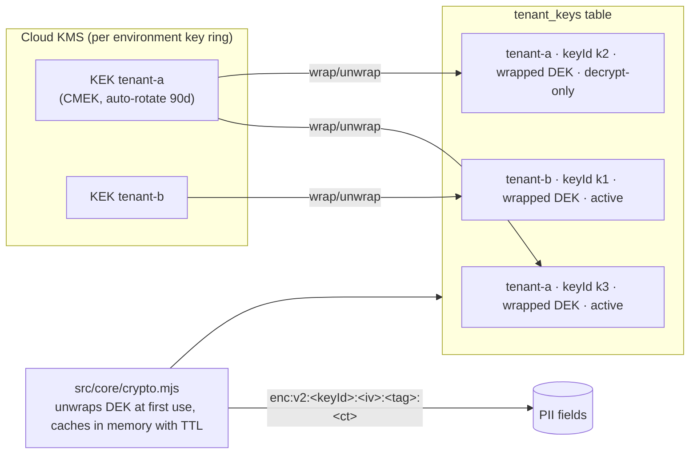

# FNOL Platform: data-protection design (v1, Sprint 1)

Status: draft for review · Owner: security (ic-security-threat-modeler) · Ticket: S1-SEC-01
Inputs: `architecture/contracts/domain/*.schema.json` (`x-pii`), `src/core/crypto.mjs`, `src/core/log.mjs`, `src/core/store.mjs`, `src/core/audit.mjs`, `TenantConfig.security` and `TenantConfig.ai`. Related: [threat-model.md](threat-model.md), [../docs/compliance-mapping.md](../docs/compliance-mapping.md).

"Implemented" means in code today. "Planned (team)" means designed but not built.

## 1. Principles

1. **Minimize.** Collect only what FNOL needs. The question sets in `TenantConfig.questionSets[].pii` mark PII answers explicitly.
2. **Encrypt PII per tenant at the field level**, before it reaches the store (standards.md). Search goes through keyed blind indexes, never plaintext columns.
3. **PII never travels in events, webhooks, logs or analytics** (overview.md D3; `includePii: const false`).
4. **The carrier is the data controller.** The platform acts as its service provider. Retention, legal hold and deletion are tenant-configurable, and every one of them is audited.
5. **Synthetic data only** in this repository, in tests, seeds and demos (section 8).

## 2. PII inventory (generated from `x-pii`)

Generated by walking every `*.schema.json` in `architecture/contracts/domain/` and collecting each node with `"x-pii": true`. To regenerate:

```sh
for f in architecture/contracts/domain/*.json; do node -e '
const s=JSON.parse(require("fs").readFileSync(process.argv[1]));const o=[];
(function w(n,p){if(!n||typeof n!=="object")return;if(n["x-pii"]===true)o.push(p);for(const[k,v]of Object.entries(n))w(v,p+"/"+k)})(s,"");
if(o.length)console.log(process.argv[1].split("/").pop(),o.join(" "))' "$f"; done
```

The output on 2026-10-18 was 14 fields in 7 schemas:

| # | Field (JSON pointer) | Schema | Category | Storage handling | Search | Response / log handling |
| --- | --- | --- | --- | --- | --- | --- |
| 1 | `/properties/firstName` | `Party.schema.json` | Identity | `encryptPii` inside `doc` | `hmacIndex` only if needed | Role-redacted in responses (planned). Log key `name` redacted (implemented) |
| 2 | `/properties/lastName` | `Party.schema.json` | Identity | `encryptPii` | `hmacIndex(lastName)` for policy and claim search | As #1 |
| 3 | `/properties/dateOfBirth` | `Party.schema.json` | Identity (sensitive) | `encryptPii` | none | **Not redacted today**: `dateOfBirth` does not contain `dob` (gap, verified) |
| 4 | `/properties/phone` | `Party.schema.json` | Contact | `encryptPii` | `hmacIndex` (normalized digits) | Log key `phone` (implemented) |
| 5 | `/properties/email` | `Party.schema.json` | Contact | `encryptPii` | `hmacIndex` (lower-cased) | Log key `email` (implemented) |
| 6 | `/properties/driversLicense` | `Party.schema.json` | Government id | `encryptPii` | none | Log key list has `license`. `driversLicense` matches, but the British spelling `licence` does not (gap) |
| 7 | `/properties/injuryDescription` | `Party.schema.json` | Health-related free text | `encryptPii`. Never sent to external AI unredacted | none | **Not covered by the log key list** (gap) |
| 8 | `/$defs/Address` (used by `Party.address`, `Property.address`, `PolicySnapshot` locations `address`, `common.Location.address`) | `common.schema.json` | Location | `encryptPii` on the serialized object | `hmacIndex(postalCode)` only if needed | Log key `address` (implemented) |
| 9 | `/properties/licensePlate` | `Vehicle.schema.json` | Vehicle identifier (PII by standards.md) | `encryptPii` | `hmacIndex` (normalized) | Log key `plate` matches `licensePlate` (implemented) |
| 10 | `/properties/description` | `LossEvent.schema.json` | Loss narrative (free text, often contains names) | `encryptPii` | none | **Not covered** (gap) |
| 11 | `/properties/body` | `Note.schema.json` | Free text | `encryptPii` | none | **Not covered** (gap) |
| 12 | `/properties/namedInsureds/items/properties/name` | `PolicySnapshot.schema.json` | Identity | `encryptPii` | `hmacIndex(lastName)` | Log key `name` (implemented) |
| 13 | `/properties/drivers/items/properties/name` | `PolicySnapshot.schema.json` | Identity | `encryptPii` | none | Log key `name` (implemented) |
| 14 | `/properties/ip` | `AuditEntry.schema.json` | Network identifier | `encryptPii` in audit `details`, or truncated to /24 | none | Not covered (gap) |

**Sensitive data not marked `x-pii`** (posted to the architecture hub as a contract follow-up; treat these as PII now):

| Field | Why | Proposed handling |
| --- | --- | --- |
| `common.Location.description` and `Location.geo` (`GeoPoint`) | Free text ("in front of 12 Example St") and precise coordinates of a home or crash identify a person | Mark `x-pii`. Round geo to 3 decimals for analytics |
| Evidence file bytes (`Document` blobs) | Photos of faces and plates, police reports | Encrypt blobs with the tenant data key (planned, evidence owner). `readContent` audited as a sensitive read |
| `intake_answers.value_enc` for questions with `pii: true` | Raw answers before mapping | Already `_enc` by contract. Enforce in intake (planned, workflow) |
| AI prompts and outputs that quote documents | They can contain any PII | Never logged. Stored only as a field-level `FieldProvenance` quote, encrypted (planned, ai) |

VINs are **not** PII (standards.md). Policy and claim numbers are identifiers, not PII. Both may appear in events and logs.

## 3. Encryption at rest

**As built (`src/core/crypto.mjs`):**

- **Master key**: `.secrets/master.key`, 32 random bytes, created `0600` in a `0700` directory with `flag: 'wx'` (no overwrite), and checked for length at boot. `.secrets/` is gitignored.
- **Per-tenant keys**: `deriveKey(tenantId, info)` = HKDF-SHA256(master, salt = tenantId, info), 32 bytes, cached in memory. Purposes in use:
  - `pii`: field encryption
  - `pii-index`: blind index
  - `_system`/`token-signing`: dev tokens (`auth.mjs`)
- **Field encryption**: `encryptPii(tenantId, value)` gives AES-256-GCM with a random 96-bit IV, serialized as `enc:v1:<iv>:<tag>:<ct>` (base64url). `decryptPii` throws on tampering or the wrong tenant, and passes non-encrypted input through unchanged. `null` passes through.
- **Blind index**: `hmacIndex(tenantId, value)` = HMAC-SHA256 with the tenant `pii-index` key over the trimmed, lower-cased value. Store it in a dedicated `<field>_idx` column and look it up with equality only.
- **Tenant-bound shortcuts**: `tctx.crypto.encryptPii(v)`, `decryptPii(v)`, `hmacIndex(v)` (`tenant-context.mjs`), so module code never passes a tenant id.

**Module rules (standards.md, enforced by `tests/security/pii-leak.test.mjs`):**

- Encrypt every `x-pii` field inside `doc` before `insert`/`update`. Indexed columns never hold plaintext PII.
- Decrypt only in the service layer, only for roles allowed to see it. Other roles get `"[redacted]"` (openapi.yaml). Responses that decrypt document content audit a sensitive read.
- `getClaimBundle` (decrypted) is internal only, for adapters and AI with redaction.

**Known gaps (see threat-model.md section 3.5):**
- No AAD, so ciphertext can be swapped between fields of the same tenant.
- No key id in the ciphertext.
- The master key is a single root.
- Blobs are not yet encrypted (no evidence module yet).

## 4. Key management and rotation path to Cloud KMS (planned, platform)

The target is envelope encryption with one Cloud KMS key per tenant, keeping the `ctx.crypto` interface unchanged.



Steps (each one is backward compatible):

1. **Versioned key ids.**
   - Add the `tenant_keys (tenant_id, key_id, purpose, wrapped_key, status, created_at, retired_at)` table. modules.md already names `tenant_keys`, but it is not built.
   - `encryptPii` writes `enc:v2:<keyId>:...` with the tenant's active key.
   - `decryptPii` accepts `v1` (HKDF-derived, read-only legacy) and `v2` (looks up `keyId`).
2. **Local driver.** Data keys (DEKs) are random 32 bytes, wrapped with the local master key (AES-KW or AES-GCM). This replaces HKDF for new writes.
3. **KMS driver (GCP).**
   - DEKs are wrapped by a per-tenant Cloud KMS key (`TenantConfig.security.piiKeyRef` holds the KMS resource name, never key material).
   - Unwrapped DEKs stay in process memory with a TTL. The Cloud Run service account has `cryptoKeyEncrypterDecrypter` on tenant keys only.
4. **Rotation.**
   - (a) KMS rotates the key-encryption key (KEK) on schedule. Rewrapping DEKs needs no data rewrite.
   - (b) DEK rotation: create a new active key id, mark the old one `decrypt-only`, then run a **re-encrypt job** per tenant:
     - It pages through tenant tables, decrypts `v1`/old `v2` values and encrypts them with the active key, in batches inside `transaction()`.
     - It is idempotent (it skips values already on the active key id) and audited (`crypto.rekey.started` and `crypto.rekey.completed` with counts, no values).
   - (c) Retire the old DEK when a scan finds zero references.
   - Blind indexes need a parallel `_idx` column under the new key until cut-over.
5. **Crypto-shred.**
   - When a tenant is off-boarded, destroy its KMS key versions after the contractual retention period ends.
   - This makes all of the tenant's ciphertext (including backups) unreadable.
   - This is only possible after step 1, because today keys are re-derivable from the master.
6. **Separate the token-signing key from the PII master.** Production uses IdP-issued OIDC tokens, and dev tokens use their own secret. Rotating PII keys must not log everyone out.

## 5. Retention schedule (defaults, tenant-configurable)

`TenantConfig.security.dataRetentionDays` holds the tenant override. Every value below is a **default for the PoC and must be set by the carrier** to match its record-retention obligations (state market-conduct record rules typically require claim files for several years after closure).

| Data | Default retention | Trigger | Disposal | Status |
| --- | --- | --- | --- | --- |
| Abandoned intake sessions (`intake_sessions`, `intake_answers`) | 30 days after `expires_at` | Session not submitted | Hard delete | Planned (workflow) |
| Claim record and parties (`claims`, `claim_*`) | 7 years after `closed` (illustrative) | Claim closed | Delete rows. On tenant exit, crypto-shred | Planned (workflow) |
| Evidence blobs and extractions | Same as the claim | Claim closed | Delete blob and row | Planned (evidence owner) |
| Audit log | 7 years (illustrative); never shorter than the claim it covers | Entry time | Archive to WORM (Bucket Lock), then delete | Planned (platform). Triggers block deletes today |
| Outbox and webhook deliveries | 90 days | `created_at` | Delete (events hold no PII) | Planned (integrations) |
| `bus_handled` dedupe rows | 30 days | `handled_at` | Delete | Planned (platform) |
| Application logs | 30 days hot, 1 year cold | Log time | Cloud Logging retention | Planned (platform) |
| AI telemetry (no PII) | 13 months | Event time | BigQuery partition expiry | Planned (ai) |
| Legal hold | Suspends all of the above for a claim | `add_flag: legal_hold` | Release audited | Planned (workflow) |

Deletion jobs run per tenant through `ctx.forTenant(tenantId).db` and record an audit entry with counts only. Because the audit triggers forbid DELETE, archiving needs a sanctioned core function that copies to WORM and then drops whole closed partitions (platform design item).

## 6. Log redaction rules

**As built (`src/core/log.mjs`).** Logs are JSON lines. `redact()` deep-copies `fields` (depth 6). Any **key** matching

```
/name|email|phone|dob|address|ssn|license|plate/i
```

has its value replaced with `"[redacted]"`. `Error` objects become `{ message, code }`. The `msg` string is **not** inspected.

Because the regex is a substring match, `firstName`, `lastName`, `licensePlate`, `driversLicense`, `emailAddress` and `phoneNumber` are redacted. It also over-redacts `filename` and `hostname`, which is acceptable. We checked this by calling `redact()` on 2026-10-18. `dateOfBirth`, `driversLicence`, `injuryDescription`, `description`, `body` and `ip` came back **unredacted**.

**Gaps and required rules (planned, platform). Modules must follow the module rules below from now on:**

| Gap | Example | Rule |
| --- | --- | --- |
| `dateOfBirth` does not contain `dob` | `{ dateOfBirth: '1990-01-01' }` is logged | Add `birth` to the key list |
| Free-text `x-pii` fields | `description`, `body`, `injuryDescription`, `narrative` | Add `description\|body\|narrative\|injury\|note` to the key list, or redact by the `x-pii` field names generated from section 2 |
| `licence` spelling | `driversLicence` | Add `licen[cs]e` |
| `ip` | `{ ip: '203.0.113.7' }` | Add `\bip\b` |
| Values under neutral keys | `error: e.message` where the message quotes input (`bus.mjs` logs handler errors this way and stores them in `outbox.last_error`) | Modules throw `AppError` with codes and ids, never values. Core truncates and scrubs `error` strings |
| `msg` text | `log.info('created claim for Jane')` | Module rule: `msg` is a constant string. Variables go in `fields` |

Module rules:
- Log ids, codes, counts, durations and `tenantId`/`requestId`.
- Never log request bodies, decrypted values, prompts or model outputs.
- `tests/security/pii-leak.test.mjs` captures stdout and asserts that distinctive synthetic PII never appears.

## 7. PII in transit and in other sinks

- **Events and webhooks.** Ids, codes and scores only (envelope description, D3). `TenantConfig.notifications.webhooks.includePii` is `const false`.
- **Adapters.** `getClaimBundle` decrypts for the claims-port mapping. The preview masks PII unless the role allows it (openapi.yaml). Transport is TLS to the carrier endpoint (planned).
- **AI providers.** `redactPiiBeforeModel` (default true) tokenizes `x-pii` values before external calls. `ai.region` pins processing. Provider terms must include no training on customer data. `provider: local` is a full opt-out (threat-model.md section 6).
- **Audit.**
  - `details` must replace PII values with `"[pii]"` (domain-model.md). Core does not enforce this yet (planned).
  - The audit `ip` is `x-pii`.
- **Backups.** These are SQLite file copies locally. On GCP they are Cloud SQL backups with CMEK. Field-level ciphertext stays encrypted inside the backups, and crypto-shred covers them (section 4).

## 8. Synthetic-data-only rule

This repository is a COTS proof of concept. It must never hold real personal data or real carrier artefacts.

- All people, carriers, policies, claims, addresses, plates and documents are generated from seeded generators in `tests/synthetic/` (`names.mjs`, `vin.mjs`, `documents.mjs`, `prng.mjs`). Demo tenants are fictional (tests/STRATEGY.md section 2).
- Reserved forms: phones `555-01xx`, emails at `example.test` / `example.invalid`, IPs from documentation ranges (`192.0.2.0/24`, `198.51.100.0/24`, `203.0.113.0/24`), VINs with a valid check digit and a synthetic manufacturer.
- No real carrier names, logos, policy formats or system names. Adapters are vendor-neutral (`core-claims-suite`, `mock-pas`).
- No secrets in git: `.secrets/`, `data/`, `*.db`, `.env` are gitignored. Keys are generated locally at first boot.
- A licensee's production data never enters this repository or its CI. Customer environments are separate deployments with their own KMS keys.
- Review check (standards.md item 6): grep new fixtures for names not produced by the generators, and for emails outside the reserved domains.
