# Domain model

Status: v1.0.0 · Owner: dir-architecture · Schemas: `architecture/contracts/domain/*.schema.json` (JSON Schema 2020-12, `$id` base `https://contracts.fnol-platform.example/domain/`)

## 1. Entities at a glance

```mermaid
classDiagram
  class Claim {
    id, tenantId, claimNumber
    status, lob, lossType, channel
    policyNumber, riskState
    checks, triage, routing, flags
    externalRefs, version
  }
  class LossEvent { lossDate, lossTime, cause, description, location, injuriesReported }
  class PolicySnapshot { policyNumber, status, period, coverages, vehicles, properties }
  class CoverageVerification { outcome, checks, matchedCoverages }
  class Party { roles[], kind, name*, phone*, email*, address* }
  class Vehicle { role, vin, plate*, damageAreas, drivable }
  class Property { role, address*, damagedAreas, habitable }
  class Document { kind, contentType, sha256, extraction }
  class TriageResult { severityScore 0-100, complexity, fraud, subrogation, explanation, ai }
  class RoutingDecision { outcome, queue, adjusterId, fastTrack, ruleIds }
  class RegulatoryTimer { state, kind, dueAt, status }
  class Task
  class Note
  class Reserve
  class IntakeSession { lob, channel, answers, questionSetVersion }
  class TenantConfig { branding, lobs, questionSets, rules, queues, timers, ai }
  class AuditEntry
  IntakeSession --> Claim : submit creates
  Claim *-- LossEvent
  Claim *-- "0..*" Party
  Claim *-- "0..*" Vehicle
  Claim *-- "0..*" Property
  Claim --> PolicySnapshot
  Claim --> "0..*" CoverageVerification
  Claim --> "0..*" Document
  Claim --> "0..*" TriageResult : attempts
  Claim --> "0..*" RoutingDecision
  Claim --> "0..*" RegulatoryTimer
  Claim --> "0..*" Task
  Claim --> "0..*" Note
  Claim --> "0..*" Reserve
  TenantConfig ..> IntakeSession : question set
  TenantConfig ..> RoutingDecision : rules, queues
  TenantConfig ..> RegulatoryTimer : timer definitions
```



`*` marks a PII field. `Claim` is the aggregate root, and the `claims` module owns it. The other entities are owned by the module that produces them (see `contracts/modules.md`) and reference the claim by `claimId`.

| Schema file | Entity | Owner module | Notes |
| --- | --- | --- | --- |
| `common.schema.json` | shared `$defs` | architecture | Id, TenantId, Timestamp, Money, Address, Location, LossCause, Channel, Role, AiProvenance, FieldProvenance, Actor, I18nText, **Condition** |
| `Claim.schema.json` | Claim | claims | Embeds LossEvent and, on read, parties, vehicles and properties |
| `LossEvent.schema.json` | LossEvent | claims | Value object inside a Claim |
| `PolicySnapshot.schema.json` | PolicySnapshot | coverage | Coverages, limits, deductibles, vehicles and property, period, status |
| `CoverageVerification.schema.json` | CoverageVerification | coverage | Added to carry the result of a coverage check |
| `Party.schema.json` | Party | claims | Roles: insured, claimant, driver, witness, third_party, passenger (plus owner, reporter, attorney, medical_provider) |
| `Vehicle.schema.json` / `Property.schema.json` | Vehicle / Property | claims | |
| `Document.schema.json` | Document / media | evidence | Kinds: photo, police_report, estimate, invoice, other. Extraction with field-level confidence and provenance |
| `Task.schema.json`, `Note.schema.json` | Task, Note | claims | |
| `Reserve.schema.json` | Reserve (placeholder) | claims | Suggested only; reserving stays in the core system |
| `TriageResult.schema.json` | TriageResult | triage | |
| `RoutingDecision.schema.json` | RoutingDecision | rules | |
| `RegulatoryTimer.schema.json` | RegulatoryTimer | claims | |
| `TenantConfig.schema.json` | TenantConfig | config | The COTS heart (section 3) |
| `AuditEntry.schema.json` | AuditEntry | core | Hash-chained per tenant |
| `IntakeSession.schema.json` | IntakeSession | intake | |
| `AdjusterView.schema.json` | Adjuster first view (read model) | adjuster | Aggregates the entities above |
| `WebhookSubscription.schema.json` | Webhook subscription | integrations | |

## 2. Conventions

- **Ids** are prefixed opaque strings: `clm_`, `ses_`, `doc_`, `pty_`, `veh_`, `prp_`, `tsk_`, `not_`, `rsv_`, `tri_`, `rte_`, `tmr_`, `cov_`, `pol_`, `aud_`, `whk_`, `evt_`. The human-facing `claimNumber` is `<claimNumberPrefix>-<year>-<6-digit sequence>`, numbered per tenant.
- **Every tenant-owned entity has `tenantId`.** It always comes from the token, never from client input.
- **PII is marked `"x-pii": true`** on the property, or on the `$def` in the case of `Address`. Core encrypts these fields with the tenant key before storage (`ctx.crypto.encryptPii`), redacts them in logs and audit diffs (`"[pii]"`), and never puts them in events. PII fields include party names, DOB, phone, email, addresses, driver's licence, licence plate, the loss narrative, note bodies, injury descriptions and audit IPs. VINs are not PII (standards.md).
- **Money** is `{ amount, currency }` in major units, with USD as the default.
- **Timestamps** are RFC 3339 UTC. `lossDate` is a calendar date in the loss time zone (`lossTimeZone`).
- **AI output.** Every AI-produced value carries `AiProvenance` (`provider`, `model`, `confidence`, `tier`, ...) and, at field level, `FieldProvenance` (the source document and quoted span, plus who confirmed it). Unconfirmed AI values have `accepted: null`.
- **Versioning.** `Claim.version` and `TenantConfig.version` increase on every write and are used for `If-Match`. The schemas are versioned in `org/contracts/registry.json`. Additive changes bump the minor version, and breaking changes bump the major version and need a decision in the architecture hub.

## 3. TenantConfig: the COTS heart

One document per tenant. The sections are listed in overview.md section 4. Key structures:

**Lines of business** (`lobs[]`): `{ id: "personal_auto", enabled, label, acordLobCd: "AUTOP", states: ["WI","IL","MI"], lossTypes: [{ id: "auto_collision", causes: ["collision", ...] }], channels }`.

**Question sets** (`questionSets[]`): `{ id, lob, lossTypes[], channels[], version, questions[] }`. Each question has:

| Field | Meaning |
| --- | --- |
| `id`, `text`, `help` | `text` may be a plain string or a locale map (`{ "en": "...", "es": "..." }`) |
| `type` | text, longtext, number, currency, boolean, date, time, datetime, select, multiselect, address, location, phone, email, vin, party, vehicle, media, disclosure |
| `required`, `requiredIf` | A static flag, or a Condition |
| `showIf` | A Condition. The question is asked only when it is true |
| `validation` | min, max, pattern, maxLength, notInFuture |
| `mapsTo` | Domain path the answer fills, e.g. `lossEvent.lossDate` or `vehicles[role=insured].drivable` |
| `pii`, `aiAssist`, `order`, `section` | |

The intake engine picks the next question in `order` whose `showIf` is true and that has no answer yet. It is `done` when no question that is required (or `requiredIf` true) is left unanswered. Rules at the `intake` stage can add questions (`require_question`) or block submission (`block_submit`).

Example:

```json
{ "id": "injuries", "text": { "en": "Was anyone hurt?" }, "type": "boolean", "required": true, "mapsTo": "lossEvent.injuriesReported", "order": 40 },
{ "id": "injured_count", "text": "How many people were hurt?", "type": "number", "validation": { "min": 1, "max": 50 },
  "showIf": { "fact": "answers.injuries", "op": "eq", "value": true }, "required": true, "order": 41 },
{ "id": "police_report_number", "text": "Police report number", "type": "text",
  "showIf": { "all": [ { "fact": "answers.police_called", "op": "eq", "value": true }, { "fact": "session.lob", "op": "eq", "value": "personal_auto" } ] }, "order": 52 }
```

**Rules** (`rules[]`): `{ id, name, enabled, stage: intake|triage|routing|post_routing, priority, stopOnMatch, appliesTo: { lobs, states, lossTypes, effectiveFrom, effectiveTo }, when: Condition, then: Action[] }`.

**Queues** (`queues[]`): `{ id, label, lobs, skills, adjusters[], assignment: round_robin|least_loaded|manual, slaHours, maxSeverity }`, together with `defaultQueue`, `fastTrack` `{ enabled, maxSeverity, maxFraudScore, maxEstimate, queue }` and `severityBands`.

**Timers** (`timers[]`): `{ id, state, lobs, kind: acknowledge|contact|decide, duration: { value, unit: hours|days|business_days }, startOn, stopOn: { event, toStatus[], taskType }, warnBefore, onBreach: Action[], citation }`. Business days skip weekends and the dates in `holidays`.

**AI** (`ai`): `{ provider: local|vertex-claude|vertex-gemini|cascade, cascade: [{ provider, model, minConfidence, tasks }], tasks: { <task>: { threshold, provider, model, enabled } }, region, redactPiiBeforeModel, maxTokensPerClaim, humanConfirmRequired }`.

## 4. Condition language v1 (`common.schema.json#/$defs/Condition`)

The language is small, JSON-only, side-effect free and deterministic. The same evaluator (`ctx.modules.rules.evaluateCondition`) serves question `showIf` and `requiredIf`, rules and timer filters.

```
Condition := { "all": [Condition, ...] }      // AND
           | { "any": [Condition, ...] }      // OR
           | { "not": Condition }
           | { "fact": <path>, "op": <op>, "value": <json> }
           | true | false
```

**Fact roots.** Facts are built per evaluation by the caller:

| Root | Contents |
| --- | --- |
| `claim.*` | Claim fields (status, lob, channel, riskState, flags, ...) |
| `loss.*` | LossEvent (`loss.cause`, `loss.lossDate`, `loss.injuriesReported`, ...) |
| `policy.*` | PolicySnapshot (`policy.status`, `policy.period.effectiveDate`, ...) |
| `coverage.*` | CoverageVerification (`coverage.outcome`) |
| `triage.*` | TriageResult (`triage.severityScore`, `triage.fraud.score`, `triage.subrogation.flag`) |
| `parties`, `vehicles`, `property`, `evidence` | Arrays. Use `[*]` to project, e.g. `vehicles[*].drivable` |
| `answers.<questionId>` | Intake answers |
| `session.*` | lob, channel, locale |
| `tenant.*` | Selected config values |
| `now` | Evaluation time |

**Operators.**

| op | Meaning |
| --- | --- |
| `eq`, `ne` | Strict equality (dates compared as ISO strings) |
| `in`, `nin` | The fact is in, or not in, the `value` array |
| `gt`, `gte`, `lt`, `lte` | Numeric, or ISO date/time comparison |
| `between` | `value: [lo, hi]`, inclusive |
| `exists`, `missing` | The fact is present and not null, or absent or null |
| `contains` | The array fact contains `value`, or the string fact contains the substring (case-insensitive) |
| `matches` | Regex (RE2-safe subset, max 200 characters) on a string fact |
| `any_eq` | Some element of a projected array equals `value` |
| `count_gte` | Array length >= `value` |
| `within_days` | The date fact is within `value` days of `now` (or of `{ "of": "<path>", "days": n }`) |

**Semantics.** A missing fact makes every comparison false except `missing` and `ne`. No coercion is done beyond ISO date strings. Evaluation stops at the first decisive result (short-circuit). A rule's evaluation result records `ruleId`, `matched`, and the leaf facts it read, for explainability.

**Actions** (`then[]`): `route_queue {queue}`, `assign_adjuster {adjusterId}`, `fast_track`, `deny_fast_track {reason}`, `add_flag {flag}`, `add_task {task}`, `require_question {questionId}`, `add_severity {points}`, `set_complexity {complexity}`, `refer_siu {reason}`, `start_timer {timerId}`, `notify {template}`, `block_submit {reason}`.

**Evaluation order.** Rules for the stage, filtered by `appliesTo`, run in ascending `priority`. All matching rules fire unless `stopOnMatch` is set. For routing, the last `route_queue` wins, and `deny_fast_track` beats `fast_track`.

Example routing rules:

```json
[
  { "id": "RT-INJURY-01", "stage": "routing", "priority": 10,
    "when": { "any": [ { "fact": "loss.injuriesReported", "op": "eq", "value": true }, { "fact": "loss.fatality", "op": "eq", "value": true } ] },
    "then": [ { "type": "route_queue", "queue": "injury" }, { "type": "deny_fast_track", "reason": "injury" }, { "type": "add_flag", "flag": "injury" } ] },
  { "id": "RT-SIU-01", "stage": "routing", "priority": 20,
    "when": { "fact": "triage.fraud.score", "op": "gte", "value": 60 },
    "then": [ { "type": "refer_siu", "reason": "fraud score" }, { "type": "route_queue", "queue": "siu" }, { "type": "deny_fast_track", "reason": "fraud" } ] },
  { "id": "RT-FT-GLASS", "stage": "routing", "priority": 50,
    "appliesTo": { "lobs": ["personal_auto"] },
    "when": { "all": [ { "fact": "loss.cause", "op": "eq", "value": "glass" }, { "fact": "triage.severityScore", "op": "lt", "value": 20 }, { "fact": "coverage.outcome", "op": "eq", "value": "covered" } ] },
    "then": [ { "type": "fast_track" } ] }
]
```

## 5. ACORD alignment

The platform does not reproduce ACORD standards. It uses names that line up with ACORD concepts so that adapters are mostly one-to-one. The `core-claims-suite` adapter does the mapping (overview.md section 9).

| Platform field | ACORD concept (P&C XML/JSON) | Notes |
| --- | --- | --- |
| `Claim` | `ClaimsNotificationAddRq` / `Claim` | FNOL submit |
| `Claim.claimNumber` | `ItemIdInfo/AgencyId` (reporting reference) | The core claim number comes back in `externalRefs` |
| `Claim.lob` + `TenantConfig.lobs[].acordLobCd` | `LOBCd` (AUTOP, HOME, AUTOB) | |
| `LossEvent` | `ClaimsOccurrence` | |
| `LossEvent.lossDate` / `lossTime` | `LossDt` / `LossTime` | |
| `LossEvent.cause` (`LossCause` enum) | `LossCauseCd` | Platform codes; the adapter maps each to the tenant's code list |
| `LossEvent.description` | `IncidentDesc` | |
| `LossEvent.location` | `Addr` within `ClaimsOccurrence` | |
| `LossEvent.policeReport` | Police and fire report info (authority, report number) | |
| `Party` + `roles` | `ClaimsParty` / `ClaimsPartyRoleCd` (Insured, Claimant, Driver, Witness, ...) | Name, communications and address go in `GeneralPartyInfo` |
| `Vehicle` | `AutoLossInfo` / `VehInfo` (`VehIdentificationNumber`, `ModelYear`, `Manufacturer`, `Model`) | |
| `Property` | `PropertyLossInfo` / `Location` | |
| `PolicySnapshot` | `Policy`, `PersAutoLineBusiness`, `HomeLineBusiness`, `ContractTerm` (`EffectiveDt`, `ExpirationDt`) | |
| Coverage `code`, `limit*`, `deductible` | `Coverage` / `CoverageCd`, `Limit`, `Deductible` | |
| `Document` | `FileAttachmentInfo` / Attachment | |
| `Reserve` | Claims reserve concept | Placeholder |
| `Task` | Claims activity concept | |
| `TriageResult`, `RoutingDecision` | none (platform-specific) | Sent in a `com.fnolplatform_*` extension aggregate |

## 6. Storage notes (for module owners)

- Each entity is stored in its owner module's tables (see `contracts/modules.md`). The JSON payload goes in a `doc` column, and the indexed columns are `tenant_id`, `id`, `claim_id`, `status`, and timestamps.
- PII fields are encrypted inside `doc` before the write. The indexed search columns hold no PII. Where PII must be searchable (policy search by last name), store a keyed HMAC blind index.
- The audit diff in `AuditEntry.changes` replaces PII values with `"[pii]"`.
