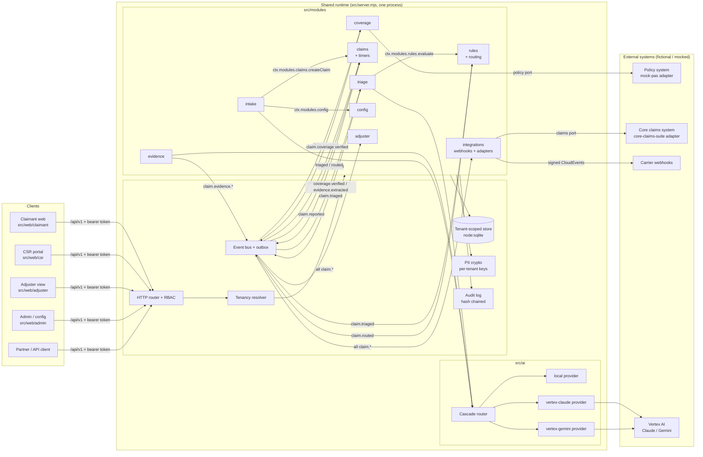
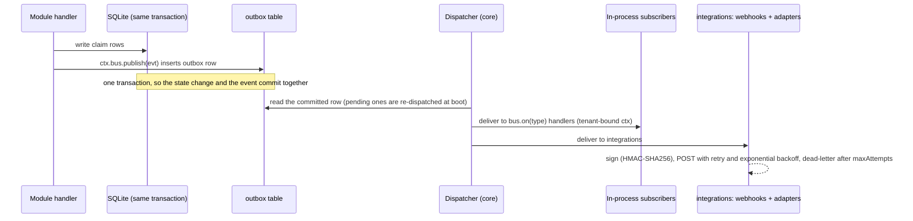
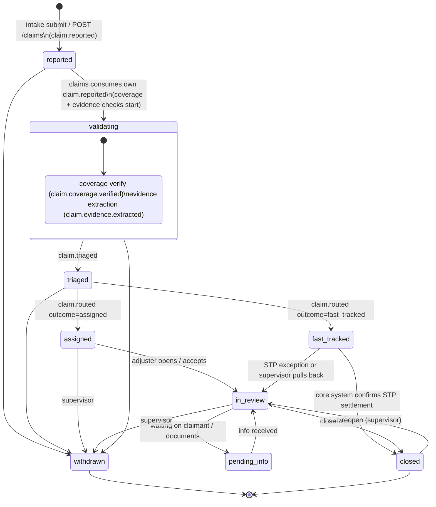
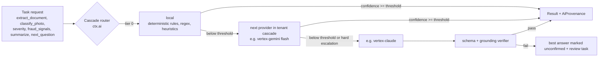

# FNOL Platform: architecture overview

Status: v1.2.0 (Sprint 2 reconciliation with the built code, S2-ARC-01; first issued v1.0.0 in S0-ARC-01) · Owner: dir-architecture · Builds on ADR-001 (stack, layout, module contract)

The FNOL platform is a commercial off-the-shelf product that any P&C carrier can license. It covers the intake window, from the first contact about a loss until the claim is triaged, routed to an adjuster (or fast tracked), and handed to the carrier's core claims system. Coverage decisions, reserving and payment stay in the carrier's system of record. The platform makes suggestions and sends them through.

Contracts are the source of truth and live in `architecture/contracts/`:

| Contract | Path |
| --- | --- |
| HTTP API (OpenAPI 3.1) | `architecture/contracts/openapi.yaml` |
| Domain entities (JSON Schema 2020-12) | `architecture/contracts/domain/*.schema.json`, explained in `architecture/domain-model.md` |
| Events (CloudEvents-style) | `architecture/contracts/events/*.schema.json` |
| Module service functions | `architecture/contracts/modules.md` |
| Registry with versions | `org/contracts/registry.json` |

## 1. Design principles

1. **One product, many carriers.** Carriers differ in configuration, not in code. A tenant config document (`TenantConfig`) holds everything a carrier changes.
2. **API first.** Every UI (claimant, CSR, adjuster, admin) is a client of the public `/api/v1`. Partners use the same API.
3. **Events are the integration fabric.** Modules talk mostly through events on `ctx.bus`. The bus writes every event to an outbox, and the outbox feeds webhooks and the core-system adapters.
4. **AI suggests, a person confirms.** Every AI output carries `provider`, `model`, `confidence` and `explanation`, and the platform works with the deterministic `local` provider when no model is configured.
5. **Ports and adapters at the edges.** The policy system and the core claims system sit behind ports. The PoC ships a mock policy system and a generic "core claims suite" adapter.
6. **Tenant isolation everywhere.** Each row has a `tenant_id`, each tenant has its own PII key, and every event, log line and audit entry is scoped to a tenant.

## 2. Component view



The modules, their service functions, the events they publish and consume, and the tables they own are listed in `contracts/modules.md`. In short:

| Module | Responsibility |
| --- | --- |
| `config` | Tenant config: load, validate, version, cache. Public subset for UIs. |
| `intake` | Guided FNOL sessions driven by question sets with conditional logic. Submitting a session creates a claim. |
| `claims` | Claim aggregate, lifecycle state machine, parties, vehicles, properties, notes, tasks, reserves (placeholder), regulatory timers. |
| `evidence` | Upload, storage, extraction (AI), human review of extracted fields. |
| `coverage` | Policy snapshot and policy search (`GET /policies?q=`) through the policy port, and the coverage check (personal auto, homeowners, commercial auto). |
| `triage` | Severity, complexity, fraud indicators, subrogation flag, explanation (AI cascade plus rules). |
| `rules` | Condition-language evaluator used by intake, triage and routing. Owns routing decisions. |
| `adjuster` | Read models: the first-view payload and the inbox. |
| `integrations` | Webhook subscriptions and delivery, the outbox API, core-system adapters (claims port). |
| `kpi` (1.2.0) | Read-only operational KPIs per tenant, tied to product value drivers (`GET /kpis`). |
| `health` | `GET /healthz` liveness. |

## 3. Multi-tenancy

**Model: shared runtime, shared database, row isolation.** This is the cheapest model to run for a COTS PoC, and it moves to a database per tenant later without changing module code because every module goes through `ctx.db`.

- **Resolution.** The bearer token's `tenantId` claim names the tenant (v1.0.0 called it `tid`; core issues `tenantId`). Only `platform_admin` may act on another tenant, with `X-Tenant-Id`. Core resolves `req.tenant` (the tenant's config and its keys) before any handler runs. Request bodies never choose the tenant. If a body carries a `tenantId` that differs from the token, the request fails with `403 tenant_mismatch`.
- **Row isolation.** Every tenant-owned table has `tenant_id TEXT NOT NULL`, and the first column of its primary key or index is `tenant_id`. `ctx.db` is bound to the request's tenant and adds `tenant_id = ?` to every statement, so a module cannot forget it (ADR-001). Event handlers get a tenant-bound context (`ctx.forTenant(evt.tenantid)`). Only `src/core` has an unscoped handle, used for migrations and the outbox dispatcher.
- **Per-tenant PII keys (as built).** Each tenant's AES-256-GCM key is derived with HKDF-SHA256 from one 32-byte master key (`.secrets/master.key` locally), using the tenant id as salt. `ctx.crypto.encryptPii(tenantId, value)` encrypts every field marked `"x-pii": true` in the domain schemas as `enc:v1:<iv>:<tag>:<ct>`; `v1` is the ciphertext format version, not a key id, and there is no `tenant_keys` table. A wrong tenant or tampering fails decryption. **Target (deferred, platform ticket):** wrapped per-tenant data keys in Cloud KMS on GCP with a key id in the ciphertext (`enc:v2:<keyId>:...`), which enables per-tenant rotation and crypto-shredding by deleting one tenant's key.
- **Isolation in events and logs.** Every event carries `tenantId`, and the bus delivers it only to handlers running in that tenant's context. Webhooks are per-tenant subscriptions. Logs carry `tenantId` and `requestId` and never carry PII.
- **Noisy neighbours.** Rate limits per tenant, and AI token budgets per tenant and per claim (`ai.maxTokensPerClaim`).
- **Testing.** `tests/integration` includes a cross-tenant leak test: tenant A's token must get a 404 for tenant B's ids on every GET route in the OpenAPI document.

## 4. Carrier configurability (the tenant config document)

`domain/TenantConfig.schema.json` is the COTS heart. One JSON document per tenant (`tenants/<tenant>.json` seeds it, and `PUT /api/v1/config` edits it). Each PUT is validated, versioned (`version` with `If-Match`), audited, and announced with `tenant.config.updated` so caches refresh.

| Section | What a carrier configures |
| --- | --- |
| `branding` | Logo, colours, font, support contacts, legal footer, state fraud-warning text |
| `lobs` | Enabled lines of business with their ACORD LOB code, states, loss types and channels |
| `questionSets` | Questions per LOB and loss type: types, validation, `showIf` / `requiredIf` conditions, `mapsTo` domain paths, PII flags, AI assist |
| `rules` | Intake, triage, routing and post-routing rules in the condition language (domain-model.md section 4) |
| `queues`, `defaultQueue`, `fastTrack`, `severityBands` | Adjuster queues, assignment strategy, fast-track limits, severity cut-offs |
| `timers`, `holidays` | Regulatory timers by state and LOB (acknowledge, contact, decide), with start and stop events, warning lead time and breach actions |
| `notifications` | Claimant and internal notifications, webhook policy (allowed hosts, signing) |
| `evidence` | Upload size cap (`maxUploadBytes`, added 1.2.0) |
| `integrations` | Which policy adapter and core-claims adapter to use, and when to push (`claim.routed` by default) |
| `ai` | Provider choice (`local`, `vertex-claude`, `vertex-gemini` or `cascade`), the cascade order, per-task thresholds, region, PII redaction before model calls, and whether human confirmation is required |

Rules and question sets are data, so a carrier can change them without a release. The `config` module does semantic validation beyond the schema: referenced queues and questions must exist, every question must be reachable, a condition's fact paths must be known, and timer start and stop events must be valid event types.

## 5. API first

- One public REST API, `/api/v1`, described by `contracts/openapi.yaml`. The UIs use no private endpoints.
- Authentication uses a bearer token. Locally that is a dev HMAC token from `POST /auth/token`. In production it is an OIDC token from the carrier's identity provider (Identity Platform or IAP) carrying the same claims. Authorization is role-based: `x-roles` on each operation is enforced by the router (`router.post(path, handler, { roles })`).
- Roles (as issued by `src/core/auth.mjs`): `claimant` (limited to the sessions and claims they started), `agent`, `csr`, `adjuster`, `supervisor`, `tenant_admin` (also accepted under its original name `carrier_admin`), `integration` (machine clients), `auditor` (read only) and `platform_admin` (operator; passes every role check). Dev tokens carry `sub`, `tenantId`, `roles`, `name`, `exp`; `claimIds` is reserved and not issued yet.
- Health: `GET /healthz` at the server root (outside `/api/v1`) returns `{ ok, modules, tenants }`.
- Conventions: cursor pagination, `Idempotency-Key` on creates, `If-Match` versioning on claims and config, and one error shape, `{ error: { code, message } }`.
- `x-module` on each operation names the module that registers the route, so ownership is clear when the router is assembled.

## 6. Event driven: bus, outbox, webhooks



- **Envelope.** `events/envelope.schema.json`, CloudEvents 1.0 style: `specversion, id, type, source, time, tenantId, subject (= claimId), data`, plus `correlationId`, `causationId` and a per-tenant `sequence`. In process the bus uses the CloudEvents extension spelling `tenantid` and source `/fnol-platform`; the outbox API, webhooks and adapters normalise to the contract envelope.
- **Sequence.** The outbox carries a per-tenant, strictly increasing `seq` (assigned in the publishing transaction, never reused). Consumers that need order use it (`GET /integrations/outbox?afterSequence=`).
- **Transactional outbox.** `ctx.bus.publish()` inside a handler writes to the `outbox` table in the same SQLite transaction as the state change. The bus in `src/core` dispatches each event asynchronously after the insert, retries a failing handler up to 3 times, marks the row `delivered` or `failed`, and re-dispatches pending rows at boot: delivery is at least once. Consumers must be idempotent on `event.id`; core dedupes per named handler in `bus_handled`.
- **No PII in events.** Events carry ids, codes and scores. Consumers fetch details through the API or `ctx.modules`. That keeps webhooks and analytics sinks out of PII scope.
- **Webhooks.** A tenant subscribes HTTPS URLs to event types (`/integrations/webhooks`). Deliveries are signed with `X-FNOL-Signature: sha256=<hmac>` and `X-FNOL-Event-Id`, retried with exponential backoff, and visible under `/deliveries`. `GET /integrations/outbox` supports replay from a sequence number.
- **Event catalogue (v1.2).** `claim.reported`, `claim.evidence.added`, `claim.evidence.extracted`, `claim.coverage.verified`, `claim.triaged`, `claim.routed`, `claim.status.changed`, `claim.timer.due`, `claim.timer.breached`, `claim.note.added`, `claim.updated` (added 1.2.0: any other claim mutation, ids and a `change` code only) and `tenant.config.updated`.

## 7. Claim lifecycle state machine

The `claims` module owns `Claim.status` and is the only module that changes it. Other modules publish facts, and `claims` reacts to them.



| From | To | Trigger | Who |
| --- | --- | --- | --- |
| (none) | `reported` | `ctx.modules.claims.createClaim` from intake submit or `POST /claims` | system |
| `reported` | `validating` | claims subscriber on `claim.reported` | system |
| `validating` | `triaged` | `claim.triaged`, the first result | system |
| `triaged` | `assigned` / `fast_tracked` | `claim.routed` | system (or a supervisor override through `POST /routing`) |
| `assigned` | `in_review` | `POST /claims/{id}/status` | adjuster, supervisor |
| `fast_tracked` | `in_review` | `POST /claims/{id}/status` | supervisor, or system when STP fails |
| `fast_tracked` | `closed` | core adapter callback or `POST /status` | system, supervisor |
| `in_review` | `pending_info` and back | `POST /status` | adjuster |
| `in_review` | `closed` | `POST /status` with `closeReason` | adjuster, supervisor |
| `closed` | `in_review` | reopen | supervisor |
| any non-terminal state | `withdrawn` | `POST /status` | csr before assignment, supervisor after |

Notes:

- Coverage and evidence run in parallel while the claim is `validating`. Their results go in `claim.checks` rather than in sub-statuses, so the state machine stays small. Triage starts on `claim.coverage.verified`, and runs with `coverage = policy_not_found` if the policy cannot be found. A rule can then route the claim to a coverage-review queue.
- **Re-triage.** A later `claim.evidence.extracted` re-runs triage while the claim is still `triaged`, `assigned` or `fast_tracked` and its inputs hash has changed. A new result can produce a new routing decision. Once a claim is `in_review`, re-triage happens only on request (`POST /triage`), and the status does not change.
- Each transition writes an audit entry and publishes `claim.status.changed` with a `version`. An illegal transition returns `409 invalid_transition`.
- **Timers.** Claims starts the timers from `TenantConfig.timers` that match the risk state and LOB when their `startOn` event arrives (by default `claim.reported`). A timer is met when its `stopOn` event arrives, for example `claim.status.changed` to `assigned` for acknowledge, or a completed `contact_insured` task for contact. A tick from `ctx.clock` publishes `claim.timer.due` at `warnAt` and `claim.timer.breached` at `dueAt`. The seeded WI, IL and MI values are illustrative and configurable, not legal advice.

## 8. Model-pluggable AI layer



- **Provider interface** (`src/ai/`). Every provider implements `complete({ task, input, schema, tenantId, budget }) -> { output, confidence, model, usage, latencyMs }`, and the result is validated against the task's JSON schema. Three providers ship: `local` (deterministic, offline, always available), `vertex-claude` (`@anthropic-ai/vertex-sdk`) and `vertex-gemini` (`@google/genai`). The SDKs load only when credentials are configured (ADR-001).
- **Cascade by confidence.** `ctx.ai.run(task, input, opts)` reads `TenantConfig.ai`. If `provider` names a single provider, that provider is used. If it is `cascade`, the router tries each entry until the confidence clears that task's threshold. Hard escalations skip ahead: injury, fatality, litigation or a CAT code goes straight to the strongest configured provider. When a provider fails or runs out of budget, the router falls back to the last good answer and marks it `unconfirmed`. Intake never blocks on AI.
- **Provenance.** Every result carries `AiProvenance` (`provider, model, confidence, tier, promptVersion, escalatedFrom`), and every extracted field carries `FieldProvenance` (the document and the quoted span). Inference telemetry goes to the log (and to BigQuery on GCP) without PII.
- **PII.** With `ai.redactPiiBeforeModel` on (the default), PII fields are tokenized before a call to an external model and restored afterwards.
- **Determinism for tests.** The `local` provider is pure. Given the same input it returns the same output, so unit and e2e tests pass offline.

## 9. Adapter seams for core systems

Two ports isolate carrier systems. Adapters are plain modules registered by id and selected per tenant through `TenantConfig.integrations`.

```js
/** Policy port: used by coverage. */
interface PolicyPort {
  getPolicySnapshot(tenantId, policyNumber, asOfDate) -> PolicySnapshot | null
  searchPolicies(tenantId, { lastName?, postalCode?, vin?, phone? }) -> PolicySummary[]
}
/** Claims port: used by integrations. */
interface ClaimsPort {
  id: 'core-claims-suite'
  map(claimBundle) -> { payload, unmapped[], warnings[] }   // pure, used by /preview
  submit(tenantId, payload) -> { externalId, status }        // FNOL create in the core system
  update(tenantId, externalId, payload) -> { status }        // later changes
}
```

- **mock-pas** (policy port) reads synthetic policies seeded for each demo tenant.
- **core-claims-suite** (claims port) is a generic, vendor-neutral example. It maps the platform claim bundle to an ACORD-aligned JSON claims notification (shaped after the ACORD claims notification add request) and posts it to a local stub endpoint. Real carrier adapters, such as one for a commercial claims suite or an in-house system, implement the same three functions. The mapping table is in `domain-model.md` section 5.

Sample mapped payload (abbreviated, synthetic):

```json
{
  "ClaimsNotificationAddRq": {
    "RqUID": "evt_01JA...",
    "TransactionRequestDt": "2026-10-18T14:02:11Z",
    "Policy": { "PolicyNumber": "HLM-PA-100245", "LOBCd": "AUTOP", "ContractTerm": { "EffectiveDt": "2026-03-01", "ExpirationDt": "2027-03-01" } },
    "ClaimsOccurrence": {
      "ItemIdInfo": { "AgencyId": "HLM-2026-000123" },
      "LossDt": "2026-10-17", "LossTime": "17:40",
      "LossCauseCd": "collision",
      "IncidentDesc": "[pii:tokenized]",
      "Addr": { "City": "Fictionville", "StateProvCd": "WI", "PostalCode": "53000" }
    },
    "ClaimsParty": [
      { "ClaimsPartyInfo": { "ClaimsPartyRoleCd": "Insured" }, "GeneralPartyInfo": { "NameInfo": { "PersonName": { "Surname": "[pii]" } } } },
      { "ClaimsPartyInfo": { "ClaimsPartyRoleCd": "Claimant" } }
    ],
    "AutoLossInfo": [{ "VehInfo": { "ModelYear": 2021, "Manufacturer": "Synthetic Motors", "VehIdentificationNumber": "1SYNT00000000000X" }, "DamageDesc": "rear bumper" }],
    "com.fnolplatform_Triage": { "SeverityScore": 32, "Complexity": "low", "FraudScore": 8, "SubrogationInd": true, "Provider": "local", "Model": "local-rules-v1", "Confidence": 0.82 }
  }
}
```

Platform-only data that has no ACORD element travels in a `com.fnolplatform_*` extension aggregate, following the ACORD convention for extensions. The adapter preview endpoint (`GET /integrations/adapters/{id}/preview/{claimId}`) shows this payload, with unmapped fields and warnings, before anything is sent.

## 10. Security and audit (summary; the threat model belongs to the security team)

- RBAC on every route, with claimant tokens scoped to their own claims.
- PII is encrypted per tenant at rest. Responses redact PII for roles that may not see it. Reading document content is audited as a sensitive read.
- The audit log is append-only and hash-chained per tenant (`prevHash`, `hash`), and records every state change, config change, routing override and sensitive read.
- No secrets in git: keys live in `.secrets/` locally and in Secret Manager or KMS on GCP.

## 11. Mapping to the GCP deployment (`docs/architecture.html`)

The PoC runs as one Node process with SQLite. The same module boundaries map onto the earlier GCP design without code changes in the modules, only in `src/core` drivers:

| PoC (local) | GCP target |
| --- | --- |
| `src/server.mjs` single process | Cloud Run service(s), stateless. All modules start as one service, and hot modules such as evidence extraction or triage can be split out as separate Cloud Run services subscribing to Pub/Sub |
| `ctx.db` on `node:sqlite` | Cloud SQL Postgres for claims, rules, ledger and the immutable audit log (row-level `tenant_id` plus Postgres RLS). Firestore for in-flight intake sessions and live adjuster or CSR updates |
| `outbox` table + in-process dispatcher | Same outbox table, relayed to Pub/Sub topics (one per event family, `tenantid` attribute) with Eventarc triggers. Cloud Tasks for rate-limited webhook and adapter calls |
| Blob folder `data/blobs/<tenant>/` | Cloud Storage with per-tenant prefixes, CMEK, and Bucket Lock for evidence |
| `.secrets/` master key | Cloud KMS key per tenant (envelope encryption) and Secret Manager |
| `vertex-claude` / `vertex-gemini` providers | Vertex AI endpoints in `ai.region` |
| Logs / telemetry | Cloud Logging, and BigQuery for analytics and AI evaluation (no PII) |
| Dev token | Identity Platform (claimants) and IAP or SSO (staff) behind the HTTPS LB and Cloud Armor |

## 12. Decisions recorded here

- **D1.** Routing lives in the `rules` module, because routing is rule evaluation plus queue assignment. Claims reacts to `claim.routed`.
- **D2.** Regulatory timers live in the `claims` module, next to the status they depend on.
- **D3.** Events carry no PII, and the webhook config cannot turn PII on in v1.
- **D4.** Coverage and evidence results are recorded in `claim.checks`, not as lifecycle sub-states.
- **D5.** The audit and auth routes are registered by `src/core` (`x-module: core`). The outbox is a core table, exposed read-only by `integrations`.
- **D6.** OpenAPI references the domain JSON Schemas directly (`$ref: domain/Claim.schema.json`), so there is one source of truth.
- **D7 (1.2.0).** Contracts describe the built code where the code is reasonable and the change is additive. Roles, the dev-token shape, `/healthz`, the in-process envelope and the crypto format are documented as built; security hardening of `src/core` (store rewrite, key ids, log redaction) goes to the platform team, not into the contract.
- **D8 (1.2.0).** Routing precedence is "first `route_queue` by ascending priority wins; approved fast track beats queue rules; `deny_fast_track` beats `fast_track`" (contracts/modules.md, rules).
- **D9 (1.2.0).** Severity band cut-offs are 0-24 / 25-49 / 50-74 / 75-100 unless the tenant overrides `severityBands` (ADR-003, domain-model.md section 3).
