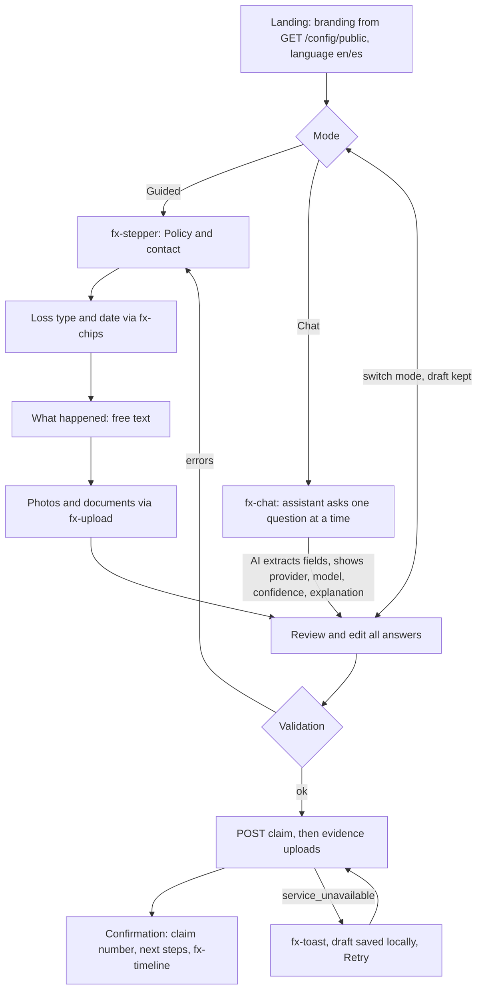
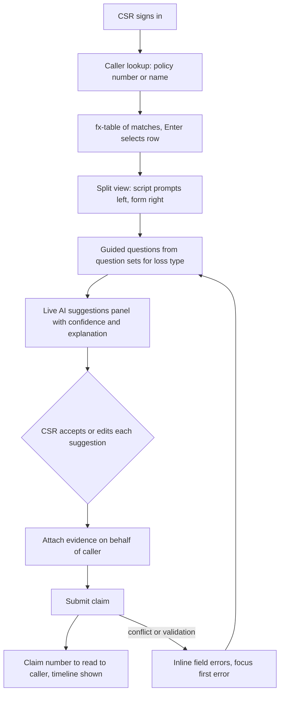
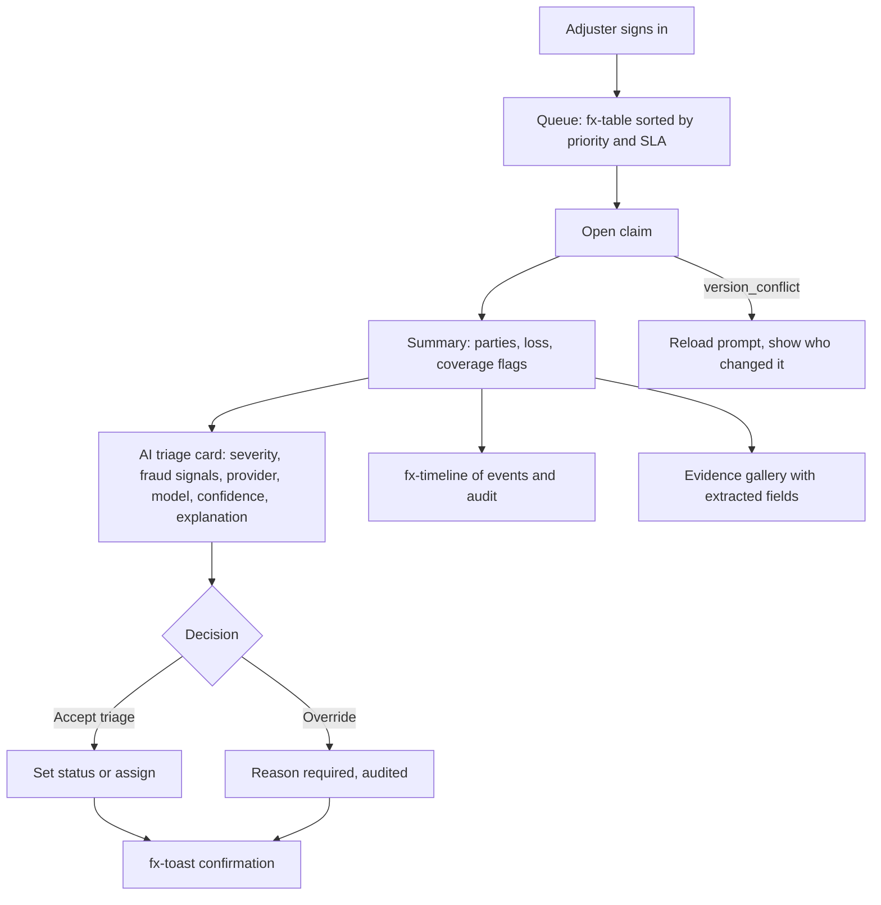
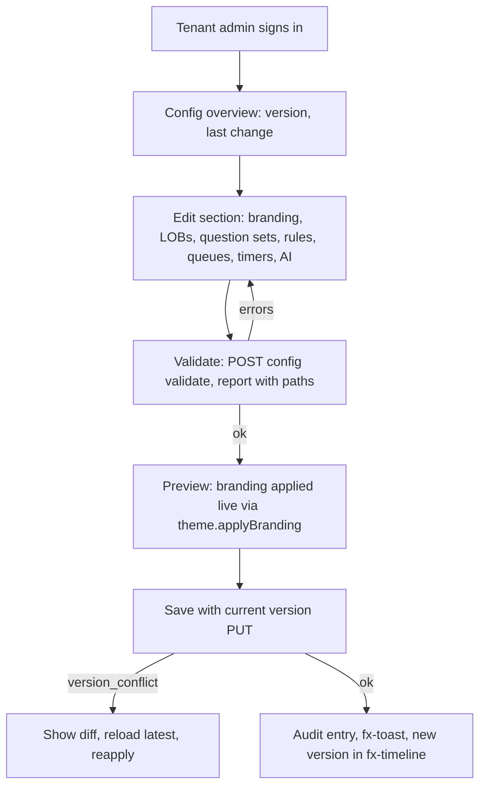

# UX flows and shared UI kit (S1-EXP-01)

Four apps share one kit in `src/web/shared/`: claimant (`/`), CSR (`/csr`), adjuster (`/adjuster`), admin (`/admin`). All data is synthetic.

## 1. Claimant: guided and conversational intake

Claimants choose a mode up front and may switch at any time; both write the same draft claim so no answers are lost.

Notes: injuries or safety keywords in chat trigger an emergency banner (call 911) before anything else. Fraud warning text from branding is shown on the review step. Every AI-suggested value is editable and labelled as a suggestion.

## 2. CSR-assisted intake

Keyboard first: full flow without a mouse, shortcuts documented on screen, no timeouts that discard data.

## 3. Adjuster first view

## 4. Carrier admin configuration

Colors must be six digit hex; the kit rejects anything else and the admin form shows the error.

## Accessibility targets (WCAG 2.2 AA)

- Contrast: text 4.5:1, large text and UI boundaries 3:1; verified for tokens by `tests/unit/web/shared/theme.test.js`. Brand text color is chosen automatically (`readableOn`).
- Target size: controls at least 24 by 24 CSS px (2.5.8), kit default 44px.
- Keyboard: all functions operable by keyboard (2.1.1), no traps; visible focus ring 3px (2.4.7, 2.4.11 focus not obscured). Chips use roving tabindex and arrow keys; table rows are focusable, header sort buttons carry `aria-sort`.
- Labels and errors: every field has a programmatic label, `aria-describedby` for hint and error, `role=alert` errors, `aria-invalid` (3.3.1, 3.3.3). Required state is text, not color alone.
- Status messages: chat log, toasts, stepper and table counts use `aria-live` or `role=status/alert` (4.1.3).
- Stepper uses an ordered list with `aria-current="step"` and text for state.
- Consistent help and no redundant entry (3.2.6, 3.3.7): draft kept across mode switches; entered data is never asked twice.
- Authentication (3.3.8): no cognitive tests; paste allowed in all fields.
- Reflow at 320px and 200% zoom; respects `prefers-reduced-motion` and `prefers-color-scheme`.
- Image previews have alt text; decorative icons are `aria-hidden`.

## Multilingual (en/es)

- `i18n.js`: `t(key, params)`, `setLocale`, `getLocale`, `registerStrings(locale, table)`. Missing keys fall back to `en`, then to the key. `<html lang>` is updated on locale change.
- Kit owns `common.*` and `kit.*`; apps register `claimant.*`, `csr.*`, `adjuster.*`, `admin.*`. A parity test enforces identical key sets and placeholders for the kit; apps should add the same test for their tables.
- Default locale from the user choice, then tenant `locales` in public config, then `en`. Tenant text (`I18nText`) resolves with `resolveText`.
- Dates use `Intl.DateTimeFormat(locale)`; phone and address formats are not locale-assumed. Strings avoid concatenation so Spanish word order works; allow about 30 percent text growth.
- Spanish copy uses formal "usted" and plain language, to be reviewed by a native speaker before production.

## Kit interface

`api.js` (`createApiClient`, `ApiError`; network, 5xx and non-envelope 404 become `service_unavailable`), `i18n.js`, `theme.js` (`applyBranding`, `setScheme`), `devlogin.js` (`devLogin`, dev mode only), `tokens.css`, `components.css`, and `components/index.js` registering `fx-field`, `fx-chips`, `fx-stepper`, `fx-upload`, `fx-chat`, `fx-timeline`, `fx-toast`, `fx-table`. Components emit `fx-change` or `fx-submit` (table rows emit `fx-select`).

Contract note: `POST /auth/token` is documented with `userId`, `displayName`, and a `201` response of `{token, expiresAt, principal}`, but core currently reads `sub` and `name` and returns `200 {token, tokenType, claims}`. `devLogin` sends both field names and returns the body untouched.
